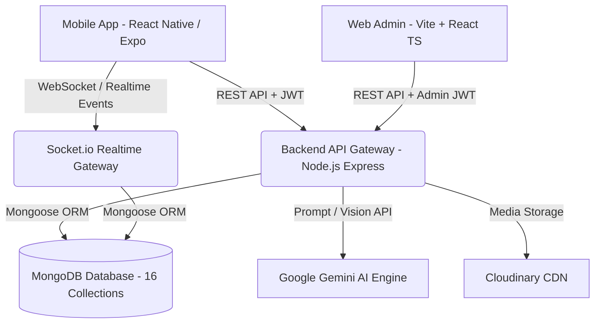
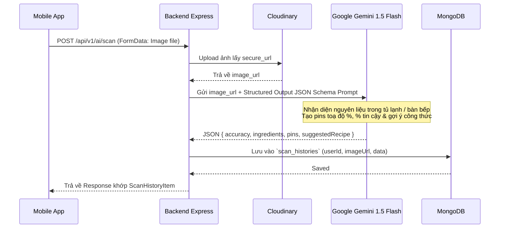

# Kế Hoạch Triển Khai Kiến Trúc Hệ Thống Backend & Web Admin - SmartCook Production Grade

> **Trạng thái:** Đã rà soát chuyên sâu 100% source code Frontend Mobile (`smartcook-mobile`), đối chiếu từng Interface, Service, Component và tài liệu SRS.
> **Mục tiêu:** Xây dựng hệ thống Backend chuẩn Production (`smartcook-backend`) và trang quản trị Web Admin Vite (`smartcook-web`) đáp ứng trọn vẹn mọi tính năng hiện tại của ứng dụng, đặc biệt là tính năng tích hợp AI và GPS.

---

## 1. Tổng Quan Hệ Sinh Thái Dự Án (Ecosystem Architecture)



- **Mobile Client (`smartcook-mobile`)**: React Native (Expo), TypeScript, Tailwind/NativeWind, Expo Router, Speech TTS tiếng Việt, Image Picker, Location GPS, Socket.io Client.
- **Backend Service (`smartcook-backend`)**: Node.js, Express.js, Socket.io (WebSocket), TypeScript, Mongoose ODM, MongoDB 7.0+, JWT Auth (Access + Refresh Token), Joi Validation, Cloudinary, Gemini AI SDK.
- **Web Admin Portal (`smartcook-web`)**: Vite + React, TypeScript, Tailwind CSS, TanStack Query, React Hook Form, Recharts.

---

## 2. Thiết Kế Cơ Sở Dữ Liệu Chi Tiết (16 MongoDB Schemas & Indexes)

Sau khi rà soát tỉ mỉ toàn bộ Frontend và tính năng Cộng Đồng & Chat Realtime mới, hệ thống chuẩn hoá **16 Collections** với kiểu dữ liệu chặt chẽ:

### 2.1. Nhóm Core & Người Dùng
#### 1. `users` Collection
Lưu trữ thông tin tài khoản, cấp bậc đầu bếp (XP), và khẩu vị cá nhân hoá.
- `_id`: `ObjectId`
- `email`: `String` (Unique, Trim, Lowercase, Indexed)
- `password`: `String` (Bcrypt hashed, `select: false` khi query thường)
- `firstName`: `String` (Từ màn Register)
- `lastName`: `String` (Từ màn Register)
- `fullName`: `String` (Virtual hoặc lưu trữ phục vụ hiển thị)
- `avatar`: `String` (URL Cloudinary)
- `role`: `String` (Enum: `['user', 'admin']`, Default: `'user'`)
- `chefExp`: `Number` (Kinh nghiệm XP tích luỹ từ việc nấu ăn, mặc định: 0, mỗi món hoàn thành +50 XP)
- `level`: `String` (Cấp bậc: "Tập sự", "Bếp gia đình", "Đầu bếp tài ba", "Bếp trưởng")
- `preferences`: `Object` (Khớp 100% với `UserPreferences` từ Onboarding Survey):
  - `hasCompletedSurvey`: `Boolean` (Default: false)
  - `portion`: `String` (Enum: `['1', '2', '3-4', '5+']`, Default: `'3-4'`)
  - `cuisines`: `[String]` (Vd: `['vietnamese', 'asian', 'healthy', 'western', 'quick', 'budget', 'vegetarian', 'dessert']`)
  - `healthGoal`: `String` (Enum: `['healthy', 'loss', 'muscle', 'budget']`, Default: `'healthy'`)
  - `restrictions`: `[String]` (Vd: `['no-spicy', 'peanut', 'seafood', 'lactose', 'vegetarian']`)
  - `tasteProfile`: `[String]` (Vd: `['dam-da', 'thanh-dam', 'cay-nong', 'ngot-thanh', 'chua-cay', 'beo-ngay']`)
  - `cookingTime`: `String` (Enum: `['quick', 'medium', 'standard', 'slow']`)
  - `updatedAt`: `Date`
- `favoriteRecipeIds`: `[{ type: ObjectId, ref: 'Recipe' }]`
- `refreshToken`: `String` (Lưu token hash hoặc whitelist để hỗ trợ Silent Refresh Token)
- `isActive`: `Boolean` (Default: true, Admin có thể khoá tài khoản)
- `createdAt`, `updatedAt`: `Date`
- **Indexes**: `{ email: 1 }` (Unique), `{ role: 1 }`

#### 2. `categories` Collection
Quản lý cây danh mục món ăn (dành cho Web Admin quản trị linh hoạt và Mobile filter).
- `_id`: `ObjectId`
- `name`: `String` (Vd: "Gia đình", "Nấu nhanh < 20p", "Healthy", "Tiết kiệm", "Trẻ em", "Ăn chay", "Món Việt", "Tráng miệng")
- `code`: `String` (Unique slug: `family`, `quick`, `healthy`, `budget`, `kids`, `vegetarian`, `vietnamese`, `dessert`)
- `color`: `String` (Mã màu HEX: `#FF6B35`, `#10B981`... đồng bộ Mobile `CATEGORIES`)
- `icon`: `String` (Tên icon Ionicons hoặc URL)
- `order`: `Number` (Thứ tự hiển thị trên thanh tabs)
- `isActive`: `Boolean` (Default: true)
- **Indexes**: `{ code: 1 }` (Unique), `{ order: 1 }`

---

### 2.2. Nhóm Nấu Ăn, Công Thức & Tủ Lạnh
#### 3. `ingredients` Collection (Thư viện nguyên liệu chuẩn)
Master Database gồm 14 nhóm nguyên liệu từ `FridgeView.tsx`.
- `_id`: `ObjectId`
- `name`: `String` (Vd: "Thịt gà", "Thịt thăn bò", "Cà chua bi", "Cá hồi phi lê", "Nước mắm")
- `normalizedName`: `String` (Tên không dấu viết thường để match nhanh: "thit ga", "thit than bo")
- `aliases`: `[String]` (Mảng từ đồng nghĩa khớp `KEYWORD_MAP` trên FE: `["ga", "dui ga", "uc ga", "canh ga"]`)
- `category`: `String` (Enum 14 nhóm: `meat`, `seafood`, `greens`, `veggies`, `herbs`, `fruits`, `egg_tofu`, `dairy`, `carbs`, `grain`, `seasoning`, `spice`, `sauces`, `dry`)
- `subCategory`: `String` (Vd: "Thịt gia cầm & heo", "Rau xanh các loại", "Dầu ăn & sốt nấu")
- `icon`: `String` (Icon name / MaterialCommunityIcons)
- `defaultUnit`: `String` (g, kg, ml, muỗng canh, quả, miếng)
- `averagePrice`: `Number` (Giá tham khảo vnđ để ước lượng giá tiền món ăn và giỏ hàng)
- **Indexes**: `{ normalizedName: 1 }`, `{ aliases: 1 }`, `{ category: 1 }`, Text Index trên `name` và `aliases`.

#### 4. `recipes` Collection (Trung tâm dữ liệu của ứng dụng)
Khớp 100% với Interface `Recipe` trong `recipe.ts` và `CreateRecipeModal.tsx`.
- `_id`: `ObjectId`
- `title`: `String` (Tên món ăn, vd: "Cơm Gà Teriyaki Áp Chảo")
- `author`: `String` (Tên tác giả hiển thị, vd: "Chef Gordon", "Minh Tuấn")
- `authorId`: `ObjectId` (Ref: `User`, null nếu là món hệ thống của Admin)
- `categoryCode`: `String` (Ref: `Category.code`, vd: "family", "healthy")
- `badge`: `String` (Tag nổi bật hiển thị trên thẻ card: "👨‍👩‍👧 Gia đình • 4 phần", "⭐ 4.9 • 30 phút")
- `sub`: `String` (Mô tả ngắn dòng phụ: "Đậm đà • Cả nhà thích")
- `description`: `String` (Mô tả chi tiết công thức)
- `image`: `String` (URL ảnh đại diện chất lượng cao)
- `minutes`: `Number` (Thời gian chế biến tổng cộng tính theo phút, vd: 25)
- `difficulty`: `String` (Enum: `['Dễ', 'Trung bình', 'Nâng cao']`)
- `servings`: `String` (Vd: "4 phần", "2 - 3 người")
- `servingsCount`: `Number` (Số khẩu phần chuẩn, phục vụ thuật toán Scaler co giãn nguyên liệu)
- `price`: `String` (Hiển thị ước tính: "~65.000đ")
- `costEstimation`: `Number` (Giá tiền số nguyên vnđ: 65000)
- `calories`: `Number` (Tổng calories mỗi khẩu phần, vd: 450)
- `rating`: `Number` (Trung bình sao đánh giá: 1.0 - 5.0, Default: 5.0)
- `reviewCount`: `Number` (Số lượng lượt đánh giá, Default: 0)
- `tags`: `[String]` (Tags tìm kiếm: `['hot', 'popular', 'new', 'dinner', 'chicken']`)
- `ingredients`: `[Object]` (Khớp `RecipeIngredient`):
  - `ingredientId`: `ObjectId` (Ref: `Ingredient`, optional)
  - `name`: `String` (Vd: "Thịt đùi gà phi lê")
  - `amount`: `String` (Vd: "400g", "2 muỗng canh", "1/2 củ")
  - `baseQuantity`: `Number` (Định lượng số cho 1 phần ăn để nhân tỷ lệ scaler)
  - `unit`: `String` (g, ml, quả, muỗng)
  - `icon`: `String` (Tên icon đại diện)
- `steps`: `[Object]` (Khớp `RecipeStep` - Chuyên dùng cho Cooking Mode):
  - `stepNumber`: `Number` (1, 2, 3...)
  - `title`: `String` (Tiêu đề bước: "Sơ chế gà", "Làm sốt Teriyaki")
  - `description`: `String` (Hướng dẫn chi tiết, được TTS giọng nói AI đọc)
  - `timerMinutes`: `Number` (Số phút hẹn giờ cho bước này, optional)
  - `tip`: `String` (Mẹo đầu bếp chuyên gia cho bước này)
- `nutrition`: `Object` (Khớp `RecipeNutrition`):
  - `calories`: `Number`
  - `protein`: `String` (Vd: "35g")
  - `carbs`: `String` (Vd: "45g")
  - `fat`: `String` (Vd: "14g")
  - `fiber`: `String` (Vd: "5g")
  - `sodium`: `String` (Vd: "680mg")
  - `advice`: `String` (Lời khuyên dinh dưỡng từ chuyên gia)
- `status`: `String` (Enum: `['published', 'pending_approval', 'draft']`, Default: `'published'`)
- `createdAt`, `updatedAt`: `Date`
- **Indexes**: 
  - Compound Index: `{ categoryCode: 1, difficulty: 1, calories: 1 }`
  - Text Index: `{ title: "text", description: "text", tags: "text" }`
  - `{ rating: -1 }`, `{ reviewCount: -1 }`, `{ status: 1 }`

#### 5. `user_fridges` Collection (Kho Tủ Lạnh Thông Minh Cá Nhân - MỚI RÀ SOÁT)
Lưu danh sách nguyên liệu người dùng đang có trong tủ lạnh (Từ tab `FridgeView.tsx`).
- `_id`: `ObjectId`
- `userId`: `ObjectId` (Ref: `User`, Indexed)
- `ingredientName`: `String` (Tên nguyên liệu, vd: "Thịt gà", "Nước tương", "Mật ong")
- `normalizedName`: `String` (Chuẩn hoá không dấu: "thit ga", "nuoc tuong")
- `category`: `String` (Nhóm: meat, veggies, sauces...)
- `quantity`: `String` (Optional, vd: "500g", "2 hộp")
- `addedAt`: `Date` (Default: Date.now)
- `isCustom`: `Boolean` (Người dùng gõ tay thêm vào hay chọn từ danh mục chuẩn)
- **Indexes**: `{ userId: 1, normalizedName: 1 }` (Unique tránh trùng)

---

### 2.3. Nhóm AI & Tương Tác Trải Nghiệm
#### 6. `scan_histories` Collection (Lịch Sử Quét AI Camera / Tủ Lạnh)
Khớp 100% cấu trúc `ScanHistoryItem` từ `scanHistoryService.ts` & `ScanAIView.tsx`.
- `_id`: `ObjectId`
- `userId`: `ObjectId` (Ref: `User`, Indexed)
- `title`: `String` (Vd: "Bàn bếp chuẩn bị trưa nay", "Ngăn mát tủ lạnh sáng nay")
- `imageUrl`: `String` (URL ảnh chụp/tải lên từ Cloudinary)
- `scannedAt`: `Date` (Thời gian quét)
- `accuracy`: `Number` (Độ chính xác nhận diện tổng quan: 90 - 99%)
- `ingredients`: `[Object]` (Khớp `ScanDetectedIngredient`):
  - `name`: `String` (Vd: "Thịt ức gà", "Cà chua bi", "Quả bơ sáp")
  - `confidence`: `String` (Vd: "98%", "96%")
  - `icon`: `String` (Icon hiển thị: "food-drumstick", "fruit-cherries")
- `pins`: `[Object]` (Khớp `ScanPin` - Toạ độ ghim nhãn nhận diện trên ảnh):
  - `text`: `String` (Vd: "🍗 Ức gà (98%)")
  - `top`: `Number` (Toạ độ %)
  - `bottom`: `Number` (Toạ độ %)
  - `left`: `Number` (Toạ độ %)
  - `right`: `Number` (Toạ độ %)
- `suggestedRecipe`: `Object` (Khớp `ScanSuggestedRecipe` - Món ăn AI gợi ý tối ưu):
  - `recipeId`: `ObjectId` (Ref: `Recipe`, optional)
  - `title`: `String` (Vd: "Salad Ức Gà Bơ Sáp Sốt Chanh Leo")
  - `desc`: `String` (Lý do gợi ý từ 100% nguyên liệu quét được)
  - `calories`: `Number`
  - `durationMinutes`: `Number`
  - `matchPercent`: `Number` (Vd: 95%, 100%)
- **Indexes**: `{ userId: 1, scannedAt: -1 }`

#### 7. `cooking_histories` Collection (Nhật Ký Nấu Ăn & XP Gamification)
Khớp 100% cấu trúc `CookingHistoryItem` từ `cookingHistoryService.ts` & `cooking-mode.tsx`.
- `_id`: `ObjectId`
- `userId`: `ObjectId` (Ref: `User`, Indexed)
- `recipeId`: `ObjectId` (Ref: `Recipe`, Indexed)
- `recipeName`: `String` (Tên món ăn đã nấu)
- `image`: `String` (URL ảnh món ăn)
- `cookedAt`: `Date` (Thời gian hoàn thành)
- `durationMinutes`: `Number` (Thời gian người dùng nấu thực tế, vd: 25)
- `servings`: `Number` (Số phần đã nấu, vd: 3)
- `usedIngredients`: `[String]` (Danh sách nguyên liệu đã tích chọn sử dụng)
- `calories`: `Number` (Lượng calo đã nạp)
- `rating`: `Number` (Số sao đánh giá nhanh sau khi nấu: 1 - 5)
- `xpEarned`: `Number` (Điểm kinh nghiệm nhận được, vd: 50)
- `completedPhotoUrl`: `String` (Ảnh chụp thành phẩm người dùng chụp chia sẻ)
- **Indexes**: `{ userId: 1, cookedAt: -1 }`

#### 8. `reviews` Collection (Đánh Giá & Nhận Xét Món Ăn)
- `_id`: `ObjectId`
- `recipeId`: `ObjectId` (Ref: `Recipe`, Indexed)
- `userId`: `ObjectId` (Ref: `User`)
- `rating`: `Number` (1 - 5 sao, bắt buộc)
- `comment`: `String` (Nội dung nhận xét)
- `images`: `[String]` (Ảnh feedback món ăn của người dùng)
- `likesCount`: `Number` (Default: 0)
- `createdAt`: `Date`
- **Indexes**: `{ recipeId: 1, createdAt: -1 }`, `{ userId: 1 }`

---

### 2.4. Nhóm Kế Hoạch, Giỏ Hàng & Định Vị Siêu Thị
#### 9. `meal_plans` Collection (Lập Kế Hoạch Bữa Ăn Theo Tuần)
Khớp cấu trúc lịch ăn 7 ngày từ `PlannerView.tsx`.
- `_id`: `ObjectId`
- `userId`: `ObjectId` (Ref: `User`, Indexed)
- `weekStartDate`: `Date` (Ngày đầu tuần - Thứ 2)
- `days`: `[Object]` (7 ngày: Thứ 2 -> Chủ Nhật):
  - `dayOfWeek`: `String` (Vd: "Thứ 2", "Thứ 3"...)
  - `date`: `String` (Vd: "2026-09-17")
  - `meals`: `[Object]`:
    - `slot`: `String` (Enum: `['Bữa Sáng', 'Bữa Trưa', 'Bữa Tối', 'Bữa Phụ']`)
    - `time`: `String` (Vd: "07:00", "12:00", "19:00")
    - `recipeId`: `ObjectId` (Ref: `Recipe`)
    - `calories`: `Number`
    - `isCooked`: `Boolean` (Default: false)
- **Indexes**: `{ userId: 1, weekStartDate: 1 }` (Unique per user/week)

#### 10. `cart_items` Collection (Danh Sách Mua Sắm & Đi Chợ)
Khớp 100% cấu trúc `CartItem` từ `cartService.ts` và danh sách đi chợ trong `PlannerView.tsx`.
- `_id`: `ObjectId`
- `userId`: `ObjectId` (Ref: `User`, Indexed)
- `name`: `String` (Tên nguyên liệu cần mua, vd: "Thịt thăn bò Tenderloin")
- `amount`: `String` (Định lượng: "500g", "1 vỉ")
- `price`: `Number` (Giá dự kiến: 85000)
- `recipeTitle`: `String` (Ghi chú mua cho món ăn nào, vd: "Bò Bít Tết Sốt Tiêu")
- `recipeId`: `ObjectId` (Ref: `Recipe`, optional)
- `bought`: `Boolean` (Đã mua hay chưa, Default: false)
- `category`: `String` (Vd: "Thịt & Cá", "Rau củ", "Bơ & Gia vị")
- `addedAt`: `Date` (Default: Date.now)
- **Indexes**: `{ userId: 1, bought: 1 }`

#### 11. `stores` Collection (Chuỗi Siêu Thị & Cửa Hàng Tiện Lợi - GeoSpatial)
Khớp 100% cấu trúc `Store` từ `mockStores.ts` & `storeService.ts`. Thay thế hardcode trên FE bằng Geo Query MongoDB.
- `_id`: `ObjectId`
- `name`: `String` (Vd: "WinMart+ Nguyễn Thị Minh Khai", "Co.opmart Cống Quỳnh")
- `brand`: `String` (WinMart, Co.opmart, Tops Market, Bách Hóa Xanh, Emart, Lotte Mart, Big C...)
- `address`: `String` (Vd: "123 Nguyễn Thị Minh Khai, P. Bến Thành, Quận 1, TP.HCM")
- `openHours`: `String` (Vd: "06:00 - 22:00")
- `phone`: `String` (Vd: "028 7108 1368")
- `logo`: `String` (URL logo chuỗi siêu thị)
- `location`: `Object` (GeoJSON Point bắt buộc cho MongoDB 2dsphere):
  - `type`: `String` (Luôn là `"Point"`)
  - `coordinates`: `[Number]` (`[longitude, latitude]` chuẩn GeoJSON - vd: `[106.6909, 10.7769]`)
- `isActive`: `Boolean` (Default: true)
- **Indexes**: **`{ location: "2dsphere" }`** (Chỉ mục không gian địa lý phục vụ toán tử `$near` / `$geoNear` tính khoảng cách tức thì theo mét/km)

#### 12. `notifications` Collection (Thông Báo Ứng Dụng)
- `_id`: `ObjectId`
- `userId`: `ObjectId` (Ref: `User`, Indexed)
- `title`: `String` (Vd: "Đến giờ chuẩn bị bữa tối!", "Nhắc nhở đi chợ")
- `body`: `String` (Nội dung thông báo)
- `type`: `String` (Enum: `['meal_reminder', 'cooking_timer', 'shopping_reminder', 'community', 'system']`)
- `data`: `Object` (Chứa `recipeId`, `postId`, `conversationId` điều hướng)
- `isRead`: `Boolean` (Default: false)
- `createdAt`: `Date` (TTL Index tự xoá sau 30 ngày)
- **Indexes**: `{ userId: 1, isRead: 1 }`, `{ createdAt: 1 }` (ExpireAfterSeconds: 2592000)

---

### 2.5. Nhóm Cộng Đồng & Chat Realtime (Socket.io)
#### 13. `posts` Collection (Bài Đăng Chia Sẻ Món Ăn, Cảm Xúc Đa Dạng & Share Bài)
- `_id`: `ObjectId`
- `author`: `ObjectId` (Ref: `User`, Indexed, Required)
- `caption`: `String` (Nội dung chia sẻ, kinh nghiệm, mẹo vặt, thành quả nấu)
- `images`: `[{ url: String, publicId: String }]` (Ảnh món ăn upload Cloudinary, hỗ trợ nhiều ảnh)
- `recipe`: `ObjectId` (Ref: `Recipe`, optional - liên kết công thức nếu bài viết làm từ công thức có sẵn)
- `tags`: `[String]` (Vd: `['monngonmoingay', 'healthy', 'nauandongian']`)
- `reactions`: `[Object]` (Chi tiết danh sách cảm xúc của từng thành viên):
  - `user`: `ObjectId` (Ref: `User`, Indexed)
  - `type`: `String` (Enum: `['like', 'love', 'haha', 'wow', 'sad', 'angry']`)
  - `createdAt`: `Date` (Default: Date.now)
- `reactionCounts`: `Object` (Bộ đếm cached tối ưu hiển thị nhanh icon và số lượng từng loại cảm xúc):
  - `like`: `Number` (Default: 0 - Thích)
  - `love`: `Number` (Default: 0 - Yêu thích / Thả tim)
  - `haha`: `Number` (Default: 0 - Cười vui / Haha)
  - `wow`: `Number` (Default: 0 - Trầm trồ / Wow)
  - `sad`: `Number` (Default: 0 - Buồn / Chia buồn)
  - `angry`: `Number` (Default: 0 - Giận dữ / Phẫn nộ)
- `totalReactions`: `Number` (Tổng số cảm xúc = like + love + haha + wow + sad + angry, Default: 0)
- `commentsCount`: `Number` (Default: 0)
- `sharesCount`: `Number` (Default: 0 - Số lượt chia sẻ bài viết)
- `sharedPost`: `ObjectId` (Ref: `Post`, optional - ID bài viết gốc nếu đây là bài viết được share lại)
- `isPinned`: `Boolean` (Default: false)
- `createdAt`, `updatedAt`: `Date`
- **Indexes**: `{ createdAt: -1 }`, `{ author: 1, createdAt: -1 }`, `{ totalReactions: -1 }`, `{ 'reactions.user': 1 }`

#### 14. `comments` Collection (Bình Luận Bài Viết)
- `_id`: `ObjectId`
- `post`: `ObjectId` (Ref: `Post`, Indexed, Required)
- `author`: `ObjectId` (Ref: `User`, Required)
- `content`: `String` (Nội dung bình luận)
- `parentComment`: `ObjectId` (Ref: `Comment`, optional - hỗ trợ reply comment nhiều cấp)
- `reactions`: `[Object]` (Thả cảm xúc bình luận):
  - `user`: `ObjectId` (Ref: `User`)
  - `type`: `String` (Enum: `['like', 'love', 'haha', 'wow', 'sad', 'angry']`)
- `totalReactions`: `Number` (Default: 0)
- `createdAt`, `updatedAt`: `Date`
- **Indexes**: `{ post: 1, createdAt: 1 }`, `{ post: 1, parentComment: 1 }`

#### 15. `conversations` Collection (Cuộc Trò Chuyện Chat)
- `_id`: `ObjectId`
- `participants`: `[{ type: ObjectId, ref: 'User' }]` (Mảng 2 userId cho chat 1-1, hoặc nhiều hơn)
- `lastMessage`: `Object` (Phục vụ hiển thị danh sách hội thoại không cần scan table messages):
  - `sender`: `ObjectId` (Ref: `User`)
  - `text`: `String`
  - `mediaUrl`: `String`
  - `createdAt`: `Date`
- `unreadCounts`: `Map<String, Number>` (Key là `userId.toString()`, Value là số tin chưa đọc)
- `createdAt`, `updatedAt`: `Date`
- **Indexes**: `{ participants: 1 }`, `{ updatedAt: -1 }`

#### 16. `messages` Collection (Tin Nhắn Chat Realtime)
- `_id`: `ObjectId`
- `conversation`: `ObjectId` (Ref: `Conversation`, Indexed, Required)
- `sender`: `ObjectId` (Ref: `User`, Indexed, Required)
- `text`: `String` (Nội dung tin nhắn)
- `mediaUrl`: `String` (Ảnh chụp món ăn gửi kèm trực tiếp trong đoạn chat)
- `isRead`: `Boolean` (Default: false)
- `createdAt`, `updatedAt`: `Date`
- **Indexes**: `{ conversation: 1, createdAt: -1 }` (Tối ưu tải lịch sử tin nhắn lùi phân trang)

---

## 3. Kiến Trúc Tích Hợp Trí Tuệ Nhân Tạo (AI Engine Integration)

Người dùng đặc biệt yêu cầu tích hợp AI. SmartCook sẽ tích hợp **Google Gemini 1.5 Flash API** (tối ưu chi phí, độ trễ cực thấp < 1.5s và khả năng Multimodal Vision xuất sắc):



### Các Luồng AI Được Thiết Kế Chuyên Biệt:
1. **AI Fridge & Tabletop Vision Scanner (`/api/v1/ai/scan`)**:
   - Nhận ảnh từ Camera hoặc Thư viện ảnh của người dùng.
   - Sử dụng Gemini Vision với `responseSchema` ép kiểu JSON trả về: danh sách nguyên liệu (`name`, `confidence`), toạ độ ghim nhãn (`pins: {text, top, left, right, bottom}`), và món ăn sáng tạo tối ưu nhất không cần mua thêm (`suggestedRecipe`).
2. **AI Smart Recipe Generator (`/api/v1/ai/generate-recipe`)**:
   - Người dùng tick chọn những gì còn lại trong tủ lạnh (`FridgeView`).
   - AI sinh công thức món ăn mới theo khẩu vị (`tasteProfile`), mục tiêu (`healthGoal`), và thời gian nấu (`cookingTime`).
3. **AI Nutrition Advisor (`/api/v1/ai/analyze-nutrition`)**:
   - Tự động bóc tách và phân tích Calo, Protein, Carbs, Fat từ danh sách nguyên liệu công thức mới người dùng nhập vào.

---

## 4. Kiến Trúc Backend Node.js & Cấu Trúc Mã Nguồn (N-Tier Architecture)

Backend sẽ tuân thủ nghiêm ngặt mô hình nhiều tầng để đảm bảo tính module hoá, dễ test và scale:

```text
smartcook-backend/
├── src/
│   ├── config/             # DB Connection (MongoDB), Cloudinary, Gemini AI client, JWT config
│   ├── constants/          # HTTP Status, Error Codes, Regex, Default Preferences
│   ├── models/             # 16 Mongoose Schemas & TypeScript Interfaces
│   │   ├── User.ts
│   │   ├── Category.ts
│   │   ├── Ingredient.ts
│   │   ├── Recipe.ts
│   │   ├── UserFridge.ts
│   │   ├── Post.ts             # Bài đăng cộng đồng
│   │   ├── Comment.ts          # Bình luận
│   │   ├── Conversation.ts     # Cuộc trò chuyện chat
│   │   ├── Message.ts          # Tin nhắn realtime
│   │   ├── ScanHistory.ts
│   │   ├── CookingHistory.ts
│   │   ├── Review.ts
│   │   ├── MealPlan.ts
│   │   ├── CartItem.ts
│   │   ├── Store.ts
│   │   └── Notification.ts
│   ├── repositories/       # Tầng tương tác CSDL trực tiếp (Tách biệt khỏi logic nghiệp vụ)
│   ├── services/           # Business Logic:
│   │   ├── auth.service.ts
│   │   ├── admin.service.ts      # Thống kê Dashboard, Quản lý thành viên (Admin Portal)
│   │   ├── user.service.ts
│   │   ├── recipe.service.ts
│   │   ├── fridge.service.ts     # Thuật toán tính % khớp tủ lạnh (Fridge Match Ranking)
│   │   ├── community.service.ts  # Bài đăng cộng đồng, comments, likes
│   │   ├── chat.service.ts       # Lịch sử hội thoại, tin nhắn
│   │   ├── ai.service.ts         # Gemini Multimodal API calls & Prompting
│   │   ├── planner.service.ts
│   │   ├── cart.service.ts
│   │   └── store.service.ts      # GeoSpatial queries ($geoNear)
│   ├── socket/             # Socket.io Realtime Gateway:
│   │   ├── index.ts              # Khởi tạo Socket.io Server, quản lý kết nối
│   │   ├── socketAuth.ts         # Middleware xác thực JWT token qua handshake
│   │   ├── chat.handler.ts       # Xử lý sự kiện phòng chat, gửi/nhận tin nhắn, typing
│   │   └── community.handler.ts  # Broadcast thông báo like/comment mới theo realtime
│   ├── controllers/        # Điều hướng Request/Response (auth, admin, recipe, community, fridge...)
│   ├── routes/             # API Endpoints (/api/v1/auth, /admin, /recipes, /posts, /fridge...)
│   ├── middlewares/        # AuthGuard (JWT), RoleGuard (Admin), Upload (Multer+Cloudinary), Validation (Joi), ErrorHandler, RateLimiter
│   ├── utils/              # Helper: Token generation, Password hashing, Logger (Winston/Morgan)
│   └── app.ts / server.ts  # Khởi chạy Express Server + Socket.io Server
├── .env.example
├── tsconfig.json
└── package.json
```

---

## 5. Thiết Kế Hệ Thống Website & Web Admin Đa Năng (`smartcook-web` - Hybrid All-in-One Architecture)

Dự án áp dụng mô hình **Hybrid All-in-One (Public Showcase & User Web App + Admin Portal)** trong cùng một codebase `smartcook-web`, kết nối trực tiếp đến hệ thống Backend API (`smartcook-backend`).

### 5.1. Tech Stack & Thư Viện Sử Dụng
- **Core Framework**: React 19 + Vite + TypeScript (Tốc độ HMR mili-giây, bundle tối ưu, hỗ trợ strict typing).
- **Styling & UI Effects**: Tailwind CSS + Framer Motion (hiệu ứng mượt mà, micro-animations, glassmorphism) + Lucide React Icons.
- **State Management & Network**:
  - `zustand`: Quản lý Auth State (User info, Access Token, Role, Theme Dark/Light), đồng bộ an toàn qua `localStorage`.
  - `axios`: Cấu hình Base Instance, Interceptors tự động đính kèm `Bearer <token>` và cơ chế **Silent Refresh Token** khi gặp lỗi 401 (`POST /auth/refresh-token`).
  - `@tanstack/react-query`: Cache dữ liệu server, tự động revalidate, xử lý phân trang vô tận (Infinite Scroll) cho công thức và newfeed.
  - `@react-oauth/google`: Đăng nhập Google One-Tap và nút "Sign in with Google" đồng bộ với endpoint `POST /auth/google`.
  - `recharts`: Vẽ biểu đồ phân tích số liệu Dashboard chuyên nghiệp (LineChart người dùng, BarChart món ăn, PieChart dinh dưỡng).
  - `react-dropzone`: Kéo thả upload ảnh món ăn trực tiếp lên Cloudinary thông qua Backend.

---

### 5.2. Kiến Trúc Phân Vùng Giao Diện (Dual-Zone Architecture)

```mermaid
graph TD
    User([Khách / Người Dùng / Admin]) --> Router{React Router Dom v7}
    Router -->|Route: / hoặc /recipes hoặc /community| PublicLayout[Public Layout - Navbar, Hero, Footer, Banner Tải App]
    Router -->|Route: /auth/*| AuthLayout[Auth Layout - Login, Register, Google OAuth]
    Router -->|Route: /admin/*| AdminGuard{Admin Role Guard}
    AdminGuard -->|Hợp lệ (role: admin)| AdminLayout[Admin Layout - Sidebar, Header, Analytics]
    AdminGuard -->|Không hợp lệ| Redirect[Chuyển hướng về /auth/login hoặc 403]
```

#### Phân Vùng 1: Public Zone & User Web App (Dành Cho Khách & Thành Viên)
1. **Trang Chủ (Landing Page - `/`)**:
   - **Hero Section**: Slogan cuốn hút, nút Call to Action ("Khám phá ngay", "Tải ứng dụng"), Mockup điện thoại iPhone 16 tương tác 3D/CSS hiển thị giao diện SmartCook Mobile, mã QR quét tải app.
   - **Interactive Showcase**:
     - *Tủ lạnh thông minh demo*: Người dùng có thể click chọn thử vài nguyên liệu trên web để xem thuật toán gợi ý món ăn ngay tức thì.
     - *Trợ lý AI Vision*: Trình diễn Before/After khi đưa ảnh bàn bếp vào AI nhận diện ghim nhãn (pins).
     - *Chế độ nấu rảnh tay (Hands-free Cooking)*: Video/Animation demo đọc giọng nói tiếng Việt từng bước nấu.
   - **Social Proof & Stats**: Thống kê 10,000+ người dùng, 500+ công thức chuẩn Việt, đánh giá 4.9⭐ từ người dùng.
   - **Download App Section**: Link chính thức lên Google Play & Apple App Store.
2. **Trang Khám Phá Công Thức (`/recipes` & `/recipes/:id`)**:
   - Bộ lọc đa tiêu chí: 14 danh mục, thời gian nấu (<20p, 30p, >1h), độ khó (Dễ, Trung bình, Khó), khẩu phần.
   - Thanh tìm kiếm full-text tự động gợi ý.
   - Trang chi tiết món ăn chuyên sâu: Dinh dưỡng (Calories, Protein, Carbs, Fat), danh sách nguyên liệu có thể tick chọn, các bước nấu có bộ đếm thời gian (Timer), nút "Lưu yêu thích", nút "Chia sẻ bài/món".
3. **Trang Mạng Xã Hội Ẩm Thực (`/community`)**:
   - Bảng tin bài đăng chia sẻ món ăn, hình ảnh thành phẩm chất lượng cao.
   - Tương tác thả 6 loại cảm xúc (`like`, `love`, `haha`, `wow`, `sad`, `angry`).
   - Bình luận và trả lời bình luận theo thời gian thực.
   - Nút chia sẻ (Share) bài viết tạo bài trích dẫn.
4. **Trang Xác Thực (`/auth/login`, `/auth/register`)**:
   - Giao diện đăng nhập hiện đại với hiệu ứng Glassmorphism.
   - Đăng nhập tài khoản mật khẩu hoặc Đăng nhập nhanh bằng Google.
   - Tự động điều hướng: Nếu tài khoản là `admin` -> chuyển thẳng vào `/admin/dashboard`, nếu là `user` -> chuyển về trang chính.
5. **Trang Thông Tin Cá Nhân (`/profile`)**:
   - Hiển thị cấp bậc đầu bếp XP, danh sách món ăn yêu thích, lịch sử các món đã nấu.
   - Cập nhật khẩu vị người dùng (Onboarding Survey).

#### Phân Vùng 2: Admin Portal (`/admin/*` - Được Bảo Vệ Bởi `AdminAuthGuard`)
1. **Trang Tổng Quan Quản Trị (`/admin/dashboard`)**:
   - **KPI Cards**: Tổng người dùng mới, tổng công thức hoạt động, số lượt quét AI hôm nay, tổng bài đăng cộng đồng.
   - **Biểu đồ trực quan (Recharts)**:
     - Biểu đồ đường (LineChart): Tăng trưởng người dùng mới theo tuần/tháng.
     - Biểu đồ cột (BarChart): Top 10 món ăn được nấu nhiều nhất trong tuần.
     - Biểu đồ tròn (PieChart): Phân bổ các nhóm nguyên liệu tủ lạnh phổ biến nhất.
2. **Quản Lý Công Thức Món Ăn (`/admin/recipes`)**:
   - Bảng danh sách công thức: Phân trang server-side, tìm kiếm theo tên, lọc theo độ khó/danh mục, bật/tắt hiển thị.
   - Form Thêm/Sửa công thức chuẩn MasterChef: Kéo thả upload ảnh lên Cloudinary, tạo nguyên liệu định lượng chuẩn, thêm nhiều bước nấu có hẹn giờ phút, hệ thống tự động bóc tách dinh dưỡng.
3. **Quản Lý Nguyên Liệu & Danh Mục (`/admin/ingredients`)**:
   - Quản lý 14 nhóm nguyên liệu tủ lạnh.
   - Thêm từ đồng nghĩa (aliases) cho từng nguyên liệu để AI nhận diện chuẩn xác tiếng Việt vùng miền.
4. **Quản Lý Hệ Thống Siêu Thị GPS (`/admin/stores`)**:
   - Danh sách chuỗi siêu thị (WinMart, Co.opmart, Tops Market...).
   - Nhập toạ độ GPS (`latitude`, `longitude`), địa chỉ, giờ mở cửa, số điện thoại để phục vụ Mobile tìm kiếm siêu thị lân cận qua `$geoNear`.
5. **Kiểm Duyệt Cộng Đồng (`/admin/community`)**:
   - Danh sách bài viết người dùng chia sẻ, quản lý bình luận.
   - Tính năng ghim bài nổi bật (`isPinned`) hoặc xoá các bài đăng/bình luận vi phạm tiêu chuẩn cộng đồng.
6. **Quản Lý Người Dùng (`/admin/users`)**:
   - Danh sách tài khoản thành viên, xem cấp bậc đầu bếp XP.
   - Khoá hoặc kích hoạt lại tài khoản (`isActive: true/false`), phân quyền quản trị viên (`role: 'admin'`).

---

### 5.3. Cấu Trúc Thư Mục Dự Án `smartcook-web`

```text
smartcook-web/
├── public/                 # Favicon, logo, ảnh minh hoạ demo
├── src/
│   ├── api/                # Cấu hình Axios Interceptors & React Query Hooks
│   │   ├── client.ts       # Axios instance, Bearer Token, Silent Refresh Token logic
│   │   ├── auth.api.ts     # Login, Register, Google Auth, Me, Survey
│   │   ├── recipe.api.ts   # CRUD Recipes, Filter, Favorites
│   │   ├── ingredient.api.ts # Categories & Ingredients
│   │   ├── community.api.ts# Posts, Reactions, Comments, Share
│   │   ├── store.api.ts    # Siêu thị & Toạ độ GPS
│   │   └── admin.api.ts    # Dashboard Stats, User Management, Moderation
│   ├── assets/             # Hình ảnh, icons, mockup điện thoại
│   ├── components/         # Reusable UI Components (Design System)
│   │   ├── ui/             # Button, Input, Modal, Badge, Dropdown, Card, Tooltip
│   │   ├── common/         # Navbar, Footer, PhoneMockup, QRDownload, EmptyState
│   │   ├── recipe/         # RecipeCard, CookingTimer, NutritionBadge
│   │   ├── community/      # PostCard, ReactionPicker (6 emojis), CommentItem
│   │   └── admin/          # StatCard, DataTable, Sidebar, PageHeader
│   ├── layouts/
│   │   ├── PublicLayout.tsx# Dành cho Trang chủ, Khám phá công thức, Cộng đồng
│   │   ├── AuthLayout.tsx  # Dành cho Login, Register
│   │   └── AdminLayout.tsx # Dành cho Phân vùng Quản trị (Sidebar + Header)
│   ├── pages/
│   │   ├── public/         # LandingPage, RecipeListPage, RecipeDetailPage, CommunityPage
│   │   ├── auth/           # LoginPage, RegisterPage
│   │   ├── user/           # ProfilePage, MyFavoritesPage
│   │   └── admin/          # DashboardPage, RecipeListPage, RecipeFormPage, StorePage, UserPage
│   ├── routes/             # AppRoutes.tsx, AdminGuard.tsx, AuthGuard.tsx
│   ├── store/              # useAuthStore.ts (Zustand)
│   ├── types/              # TypeScript Interfaces khớp 100% Backend DTO
│   ├── utils/              # formatCurrency, formatDate, imageHelpers
│   ├── App.tsx
│   ├── main.tsx
│   └── index.css           # Tailwind directives, custom glassmorphism styles
├── index.html
├── package.json
├── tailwind.config.js
├── tsconfig.json
└── vite.config.ts
```

---

### 5.4. Kế Hoạch Triển Khai Chi Tiết smartcook-web (Step-by-Step Implementation Blueprint)

Để hiện thực hoá trang Web chuyên nghiệp này, quy trình triển khai được chuẩn hoá qua 6 giai đoạn kỹ thuật rõ ràng:

#### 1. Khởi Tạo Dự Án & Thiết Lập Môi Trường (Initialization)
- Tạo project song song với backend:
  ```bash
  cd e:\FPTU\Term07\project
  npm create vite@latest smartcook-web -- --template react-ts
  cd smartcook-web
  ```
- Cài đặt bộ dependencies chuẩn production:
  ```bash
  # Routing, Server state & Client state
  npm install react-router-dom @tanstack/react-query zustand axios
  # UI, Icons, Animations & Charts
  npm install lucide-react framer-motion recharts clsx tailwind-merge
  # Google Auth & Media Upload
  npm install @react-oauth/google react-dropzone
  # Dev tools & Styling
  npm install -D tailwindcss postcss autoprefixer
  npx tailwindcss init -p
  ```
- Cấu hình file biến môi trường `.env`:
  ```env
  VITE_API_BASE_URL=http://localhost:5000/api/v1
  VITE_GOOGLE_CLIENT_ID=your_google_client_id.apps.googleusercontent.com
  VITE_CLOUDINARY_CLOUD_NAME=your_cloud_name
  ```

#### 2. Xây Dựng Tầng Network & Silent Refresh Token Interceptor (`src/api/client.ts`)
- Khởi tạo Axios Instance với `baseURL: import.meta.env.VITE_API_BASE_URL`.
- **Request Interceptor**: Tự động lấy `accessToken` từ `useAuthStore` gắn vào Header:
  `Authorization: Bearer <accessToken>`.
- **Response Interceptor (Cơ chế Silent Refresh mượt mà)**:
  - Khi API trả về lỗi `401 Unauthorized`:
    1. Tạm dừng các request tiếp theo vào hàng đợi (*Queue*).
    2. Gọi `POST /api/v1/auth/refresh-token` với `refreshToken` lưu trong store.
    3. Nhận cặp token mới -> Cập nhật store -> Thực thi lại request bị 401 ban đầu.
    4. Nếu `refreshToken` cũng hết hạn -> Xoá store -> Chuyển hướng về `/auth/login`.

#### 3. Bảng Ánh Xạ Tích Hợp API Backend ➔ Frontend Web (API Integration Matrix)

| Chức Năng Trên Web | Backend API Endpoint | Method | Phân Vùng Sử Dụng |
| :--- | :--- | :--- | :--- |
| Đăng nhập tài khoản | `/api/v1/auth/login` | POST | Public Auth |
| Đăng nhập Google | `/api/v1/auth/google` | POST | Public Auth |
| Đăng ký tài khoản | `/api/v1/auth/register` | POST | Public Auth |
| Cấp lại token ngầm | `/api/v1/auth/refresh-token` | POST | Global Interceptor |
| Lấy thông tin cá nhân | `/api/v1/auth/me` | GET | Global Header / Profile |
| Cập nhật khẩu vị | `/api/v1/auth/survey` | POST | User Profile |
| Khám phá công thức | `/api/v1/recipes` | GET | Public / Recipes Page |
| Chi tiết công thức | `/api/v1/recipes/:id` | GET | Public / Recipe Details |
| Thích công thức | `/api/v1/recipes/:id/favorite`| POST | User Recipes |
| Danh mục & Nguyên liệu| `/api/v1/categories`, `/ingredients` | GET | Public Filters & Admin |
| Newfeed Cộng đồng | `/api/v1/posts` | GET | Public Community |
| Đăng bài + Upload ảnh | `/api/v1/posts` | POST | User Community |
| Thả cảm xúc 6 loại | `/api/v1/posts/:id/react` | POST | User Community |
| Chia sẻ bài viết | `/api/v1/posts/:id/share` | POST | User Community |
| Bình luận bài viết | `/api/v1/posts/:id/comments` | POST | User Community |
| Thống kê Dashboard | `/api/v1/admin/dashboard` | GET | Admin Only |
| CRUD Công thức Admin| `/api/v1/recipes` (CRUD) | POST/PUT/DELETE | Admin Only |
| Quản lý Siêu thị GPS| `/api/v1/stores` (CRUD) | GET/POST/PUT/DELETE | Admin Only |
| Quản lý Thành viên | `/api/v1/admin/users` | GET/PATCH | Admin Only |

#### 4. Lộ Trình Triển Khai smartcook-web Qua 6 Bước (Phases W1 -> W6)
- **Phase W1: Nền tảng Core, State & Auth Flow (Ngày 1)**:
  - Thiết lập dự án, Tailwind CSS typography, Google Fonts (Inter / Outfit).
  - Hoàn thiện `useAuthStore`, `src/api/client.ts`, màn hình Login & Register với phong cách Glassmorphism.
  - Tích hợp Đăng nhập Google 1-chạm (`@react-oauth/google`).
  - Xây dựng các Route Guards: `AuthGuard`, `AdminGuard`.
- **Phase W2: Landing Page & Public Showcase Đỉnh Cao (Ngày 2)**:
  - Hero Section: Typography lớn, Gradient sống động, nút CTA "Trải nghiệm ngay", Mockup điện thoại iPhone 16 tương tác 3D/CSS.
  - Interactive Showcase: Widget Tủ lạnh ảo click chọn nguyên liệu hiển thị món ăn gợi ý, demo AI Vision nhận diện bàn bếp, demo chế độ nấu bằng giọng nói.
  - QR Code quét tải ứng dụng trên App Store / Google Play.
- **Phase W3: Trang Khám Phá & Chi Tiết Công Thức (Ngày 3)**:
  - Trang `/recipes`: Thanh tìm kiếm full-text, bộ lọc 14 danh mục, độ khó, thời gian.
  - Trang `/recipes/:id`: Bảng calo dinh dưỡng (Calories, Carbs, Protein, Fat), danh sách nguyên liệu có checkbox tick chọn, các bước nấu có bộ đếm giờ (Timer) bấm bắt đầu/tạm dừng, nút lưu yêu thích.
  - Cấu hình thẻ OpenGraph (og:image, og:title) để khi chia sẻ link lên Facebook/Zalo sẽ hiển thị thẻ xem trước cực đẹp.
- **Phase W4: Mạng Xã Hội Ẩm Thực Cộng Đồng (Ngày 4)**:
  - Bảng tin `/community`: Danh sách bài đăng hình ảnh món ăn thành phẩm từ người dùng.
  - Tương tác 6 loại cảm xúc (`like`, `love`, `haha`, `wow`, `sad`, `angry`) kèm popover hiệu ứng nhấc nổi.
  - Khung bình luận realtime và modal trích dẫn chia sẻ bài viết (Share Post).
- **Phase W5: Phân Vùng Quản Trị Admin Portal (Ngày 5)**:
  - Layout Admin: Sidebar chuyển trang mượt mà, Topbar quản lý profile và thông báo.
  - Dashboard: KPI cards, biểu đồ Recharts (Tăng trưởng user, top món nấu nhiều nhất).
  - Quản trị công thức: Bảng phân trang, Form thêm/sửa công thức kéo thả ảnh tải lên Cloudinary.
  - Quản trị nguyên liệu, chuỗi siêu thị GPS và kiểm duyệt bài viết cộng đồng.
- **Phase W6: Kiểm Thử Toàn Diện, Responsive & Build Production (Ngày 6)**:
  - Kiểm thử hiển thị trên 4 dải màn hình: Mobile (<640px), Tablet (768px), Laptop (1024px), 4K Desktop (1920px+).
  - Tối ưu hiệu năng Lighthouse: Lazy load hình ảnh (`loading="lazy"`), Code-splitting router (`React.lazy`).
  - Chạy `npm run build` xác nhận bundle TypeScript sạch sẽ 100%.

---

## 6. Lộ Trình Triển Khai Chi Tiết (Implementation Phases)

### Giai đoạn 1: Khởi Tạo Cấu Trúc Backend & Base Authentication [ĐÃ HOÀN THÀNH 100%]
- [x] Cài đặt các thư viện cần thiết: `mongoose`, `jsonwebtoken`, `bcryptjs`, `cors`, `helmet`, `joi`, `dotenv`, `@google/genai`, `multer`, `cloudinary`, `google-auth-library`.
- [x] Thiết lập chuẩn TypeScript, kết nối MongoDB Atlas an toàn, cấu hình biến môi trường `.env` & `.env.example`.
- [x] Triển khai Bộ xử lý lỗi toàn cục (`GlobalErrorHandler`), custom error classes và chuẩn hoá định dạng phản hồi API (`ApiResponse`, `asyncHandler`).
- [x] Xây dựng Module Auth hoàn chỉnh:
  - [x] Đăng ký (`POST /auth/register`)
  - [x] Đăng nhập (`POST /auth/login`)
  - [x] Đăng nhập bằng Google (`POST /auth/google` - OpenID Connect & Account Linking)
  - [x] Cấp lại token xoay vòng bảo mật (`POST /auth/refresh-token` - RFC 7519 `jti` Rotation Protection)
  - [x] Đăng xuất thu hồi token (`POST /auth/logout`)
  - [x] Lấy thông tin cá nhân (`GET /auth/me`)
  - [x] Cập nhật thông tin profile (`PUT /auth/profile`)
  - [x] Cập nhật khảo sát khẩu vị Onboarding (`POST /auth/survey`)
- [x] Tách module tài liệu OpenAPI / Swagger (`src/docs/auth.swagger.ts`, `src/docs/health.swagger.ts`).
- [x] Tạo bộ Postman Collection hoàn chỉnh (`SmartCook_API_Collection.json`) kèm auto-save token.
- [x] Đã chạy pass toàn bộ bộ test tích hợp và merge vào nhánh `main`.

---

### Giai đoạn 2: Quản Lý Nguyên Liệu, Tủ Lạnh & Công Thức Món Ăn [ĐÃ HOÀN THÀNH 100%]
- [x] **2.1. Module Danh Mục (Category Module)**:
  - [x] Model `Category.ts` & Repository `category.repository.ts` (mã code, icon, tên, thứ tự hiển thị).
  - [x] Service, Controller, Route `GET /categories` (dành cho Mobile tabs filter) & CRUD dành cho Admin.
  - [x] Swagger docs `src/docs/category.swagger.ts`.
- [x] **2.2. Module Thư Viện Nguyên Liệu Chuẩn (Ingredients Module)**:
  - [x] Model `Ingredient.ts` & Repository `ingredient.repository.ts` (14 nhóm nguyên liệu tủ lạnh, aliases từ đồng nghĩa, đơn vị đo, giá tham khảo).
  - [x] Script Seed Data `src/data/seedIngredients.ts`: Nạp sẵn 58 nguyên liệu chuẩn từ `FridgeView.tsx` vào MongoDB Atlas.
  - [x] API tìm kiếm nguyên liệu theo từ khoá, lọc theo nhóm (`GET /ingredients?category=...&search=...`).
  - [x] Swagger docs `src/docs/ingredient.swagger.ts`.
- [x] **2.3. Module Tủ Lạnh Thông Minh Người Dùng (User Fridge Module)**:
  - [x] Model `UserFridge.ts` & Repository `fridge.repository.ts` (lưu trữ danh sách nguyên liệu trong tủ lạnh của từng user, ngày thêm, hạn sử dụng, số lượng, đơn vị, trạng thái).
  - [x] API lấy đồ trong tủ lạnh (`GET /fridge/my-fridge`).
  - [x] API thêm/sửa/xoá nguyên liệu vào tủ lạnh (`POST /fridge/items`, `PUT /fridge/items/:id`, `DELETE /fridge/items/:id`).
  - [x] API dọn sạch tủ lạnh (`DELETE /fridge/clear`).
  - [x] Swagger docs `src/docs/fridge.swagger.ts`.
- [x] **2.4. Module Công Thức Món Ăn (Recipe Module)**:
  - [x] Model `Recipe.ts` & Repository `recipe.repository.ts` (công thức, khẩu phần chuẩn `servingsCount`, mảng nguyên liệu `ingredients`, các bước nấu `steps` có `timerMinutes`, dinh dưỡng `nutrition`, độ khó, thời gian).
  - [x] Script Seed Data `src/data/seedRecipes.ts`: Nạp 5 công thức món ăn chuẩn chất lượng cao.
  - [x] API danh sách công thức: Phân trang, tìm kiếm full-text, lọc theo danh mục, thời gian nấu, độ khó (`GET /recipes`).
  - [x] API chi tiết công thức (`GET /recipes/:id`).
  - [x] API công thức yêu thích (`POST /recipes/:id/favorite`).
  - [x] Swagger docs `src/docs/recipe.swagger.ts`.
- [x] **2.5. Thuật Toán Xếp Hạng & Khớp Tủ Lạnh (Fridge Match Ranking Algorithm)**:
  - [x] Xây dựng service tính toán tỉ lệ phần trăm trùng khớp (`fridgeMatchPercent = (số nguyên liệu có sẵn / tổng nguyên liệu) * 100%`) hỗ trợ mapping từ đồng nghĩa (aliases) & normalized Vietnamese.
  - [x] API gợi ý món ăn tối ưu từ tủ lạnh (`GET /recipes/fridge-match`): Tự động sắp xếp các món có tỉ lệ khớp cao nhất lên đầu, liệt kê rõ nguyên liệu đã có và nguyên liệu cần mua thêm.
- [x] **2.6. Tích hợp & Kiểm thử**:
  - [x] Chạy test tích hợp tự động 5/5 kịch bản thành công 100%.
  - [x] Bổ sung 7 endpoints mới vào `SmartCook_API_Collection.json`.

---

### Giai đoạn 3: Phân Vùng Quản Trị Hệ Thống & Upload Media (Admin Portal & Media Service) [ĐÃ HOÀN THÀNH 100%]
- [x] **3.1. Middleware Upload Media Đa Năng (Multer + Cloudinary Stream Upload)**:
  - [x] Cấu hình `src/middlewares/upload.ts`: Multer memory storage, kiểm tra mimetype ảnh hợp lệ (jpg, png, webp), giới hạn 5MB/ảnh.
  - [x] Xây dựng tiện ích upload stream trực tiếp lên Cloudinary với folder linh hoạt (`smartcook/recipes`, `smartcook/community`, `smartcook/avatars`).
- [x] **3.2. Module Quản Trị Backend (`src/routes/admin.route.ts`, `src/controllers/admin.controller.ts`, `src/services/admin.service.ts`)**:
  - [x] Endpoint `GET /admin/dashboard`: Tổng hợp dữ liệu thống kê qua MongoDB Aggregation:
    - Thẻ KPI: Tổng người dùng (`users`), Tổng công thức (`recipes`), Tổng bài viết (`posts`), Lượt quét AI (`scan_histories`).
    - Biểu đồ tăng trưởng người dùng 7 ngày qua (phục vụ LineChart trên Web Admin).
    - Top 10 món ăn được nấu nhiều nhất và đánh giá cao nhất (phục vụ BarChart).
  - [x] Endpoint `GET /admin/users`: Lấy danh sách thành viên hỗ trợ phân trang (`page`, `limit`), tìm kiếm theo từ khóa họ tên / email, lọc theo `role` (user/admin) và `isActive`.
  - [x] Endpoint `PATCH /admin/users/:userId/status`: Khóa hoặc kích hoạt lại tài khoản người dùng (`isActive: boolean`).
  - [x] Endpoint `PATCH /admin/users/:userId/role`: Phân quyền quản trị viên (`admin`) hoặc điều chỉnh về người dùng thường (`user`).
  - [x] Bảo mật: Gắn middleware `authenticate` và `authorize('admin')` nghiêm ngặt cho toàn bộ router `/api/v1/admin`.
  - [x] Swagger Docs: `src/docs/admin.swagger.ts`.
- [x] **3.3. Chuẩn Hóa Mongoose Virtuals & DTO Adapter Cho Recipe (`src/models/Recipe.ts`)**:
  - [x] Cấu hình Virtual Getters trong Schema `Recipe.ts` để đồng bộ 100% giữa Mobile App và Web Admin:
    - Virtual `cookingTimeMinutes` ➔ ánh xạ về `minutes`.
    - Virtual `ratingAverage` ➔ ánh xạ về `rating`.
    - Virtual `ratingsCount` ➔ ánh xạ về `reviewCount`.
    - Virtual `category` ➔ ánh xạ về `categoryCode` (hoặc tên category hiển thị).
  - [x] Bật `{ virtuals: true, getters: true }` cho cả `toJSON` và `toObject`.
- [x] **3.4. Hoàn Thiện CRUD Công Thức Dành Cho Admin Kèm Upload Ảnh**:
  - [x] Nâng cấp Controller/Service của `POST /recipes` và `PUT /recipes/:id` để nhận file ảnh từ multipart/form-data, upload Cloudinary và lưu link `image` vào MongoDB.

---

### Giai đoạn 4: Tính Năng Cộng Đồng & Chat Realtime Bằng Socket.io (Community & Realtime Gateway)
- [ ] **4.1. Module Cộng Đồng (Community Posts & Comments `/api/v1/posts`)**:
  - [ ] Model `Post.ts` & `Comment.ts` kèm đầy đủ Mongoose Schemas, validation (Joi) và TypeScript Interfaces.
  - [ ] Repositories `post.repository.ts`, `comment.repository.ts`.
  - [ ] Services `post.service.ts`, `comment.service.ts`.
  - [ ] Controllers & Routes:
    - [ ] `POST /posts`: Đăng bài chia sẻ kèm upload ảnh món ăn qua Cloudinary (Multipart/form-data).
    - [ ] `GET /posts`: Lấy Newfeed cộng đồng (phân trang page/limit, sort theo mới nhất hoặc nổi bật).
    - [ ] `GET /posts/:id`: Lấy chi tiết bài đăng và danh sách comment liên quan.
    - [ ] `POST /posts/:id/react`: Thả cảm xúc đa dạng (`like`, `love`, `haha`, `wow`, `sad`, `angry`). Xử lý đổi cảm xúc hoặc gỡ bỏ khi bấm lại cùng loại.
    - [ ] `GET /posts/:id/reactions`: Lấy danh sách thành viên đã thả cảm xúc (hỗ trợ lọc theo từng loại cảm xúc).
    - [ ] `POST /posts/:id/share`: Chia sẻ bài viết (tạo bài viết trích dẫn, tăng `sharesCount` của bài gốc).
    - [ ] `POST /posts/:id/comments`: Thêm bình luận hoặc trả lời bình luận lồng nhau (`parentComment`).
    - [ ] `GET /posts/:id/comments`: Lấy danh sách bình luận theo bài viết có phân trang.
    - [ ] `POST /posts/:id/comments/:commentId/react`: Thả cảm xúc cho bình luận.
    - [ ] `DELETE /posts/:id`: Xoá bài đăng (kiểm tra quyền tác giả hoặc admin).
  - [ ] Swagger Docs: `src/docs/community.swagger.ts`.
- [ ] **4.2. Module Chat Realtime (Socket.io Gateway & Chat API)**:
  - [ ] Cài đặt gói phụ thuộc: `socket.io` và `@types/socket.io`.
  - [ ] Cấu hình `src/server.ts` tích hợp `http.createServer(app)` gắn `new Server(httpServer, { cors: ... })`.
  - [ ] Xây dựng Socket Authentication Middleware (`src/socket/socketAuth.ts`): Trích xuất và giải mã JWT token từ `socket.handshake.auth.token`, gắn `socket.data.user`.
  - [ ] Model `Conversation.ts` & `Message.ts` với đầy đủ indexes tối ưu query.
  - [ ] Repository `chat.repository.ts` & Service `chat.service.ts`.
  - [ ] Xử lý Socket Events (`src/socket/chat.handler.ts`):
    - [ ] `join_conversation`: Client gia nhập room chat `chat:<conversationId>`.
    - [ ] `leave_conversation`: Rời room chat.
    - [ ] `send_message`: Lưu tin nhắn vào MongoDB, cập nhật `lastMessage` của cuộc trò chuyện, phát tán sự kiện `receive_message` tới các thành viên trong room.
    - [ ] `typing` / `stop_typing`: Thông báo trạng thái người đối diện đang soạn tin nhắn.
    - [ ] `mark_as_read`: Đánh dấu tin nhắn đã đọc realtime.
  - [ ] REST API cho Chat:
    - [ ] `GET /chat/conversations`: Lấy danh sách cuộc trò chuyện của user hiện tại.
    - [ ] `POST /chat/conversations`: Bắt đầu hoặc lấy cuộc trò chuyện 1-1 với user khác.
    - [ ] `GET /chat/conversations/:id/messages`: Tải lịch sử tin nhắn cũ (phân trang lùi theo thời gian `cursor`).
  - [ ] Swagger Docs: `src/docs/chat.swagger.ts`.

---

### Giai đoạn 5: Tích Hợp AI Engine & GeoSpatial Siêu Thị
- [ ] Xây dựng Service tích hợp Gemini AI SDK (Model `gemini-3.6-flash`).
- [ ] Endpoint `/api/v1/ai/scan`: Tiếp nhận ảnh -> Upload Cloudinary -> Gemini Vision -> Trả về danh sách nguyên liệu, toạ độ pins, món ăn đề xuất -> Lưu `scan_histories`.
- [ ] Endpoint `/api/v1/ai/generate-recipe`: Sinh công thức sáng tạo từ nguyên liệu tủ lạnh đã chọn kết hợp khẩu vị survey.
- [ ] Cấu hình chỉ mục `2dsphere` cho `stores`. Viết Endpoint `/api/v1/stores/nearby` nhận toạ độ `latitude, longitude` từ Mobile và trả về siêu thị gần nhất kèm khoảng cách km.

---

### Giai đoạn 6: Kế Hoạch Bữa Ăn, Giỏ Hàng & Gamification Nấu Ăn
- [ ] Hoàn thiện API `meal_plans` (lịch ăn tuần 7 ngày) và `cart_items` (danh sách đi chợ).
- [ ] Hoàn thiện API `cooking_histories` (ghi nhận thời gian nấu, cộng 50 XP cho người dùng, lưu ảnh thành phẩm).
- [ ] Hoàn thiện API `reviews` (bình luận, đánh giá sao).

---

### Giai đoạn 7: Tích Hợp & Vận Hành Website Đa Năng (`smartcook-web` - Hybrid All-in-One)
- [x] **7.1. Khởi Tạo Cấu Trúc Dự Án & Xây Dựng Khung Giao Diện [ĐÃ HOÀN THÀNH 100% TRÊN CODE]**:
  - [x] Đã tạo dự án `smartcook-web` bằng Vite + React 19 + TypeScript + Tailwind CSS.
  - [x] Cấu hình Axios Client (`src/api/client.ts`) với Interceptors tự động đính kèm `Bearer Token` và xử lý **Silent Refresh Token** khi gặp mã 401.
  - [x] Đã cài đặt các thư viện: `@tanstack/react-query`, `zustand`, `lucide-react`, `framer-motion`, `recharts`, `@react-oauth/google`, `react-router-dom`.
  - [x] Đã xây dựng `useAuthStore` (Zustand): lưu `user`, `accessToken`, `role`, đồng bộ `localStorage`.
  - [x] Đã hoàn thiện giao diện Đăng nhập (`/auth/login`) và Đăng ký (`/auth/register`) với hiệu ứng Glassmorphism.
  - [x] Đã thiết lập Route Guards: `AuthGuard`, `AdminGuard`.
  - [x] Đã code hoàn chỉnh các trang Public: `LandingPage`, `RecipeListPage`, `RecipeDetailPage`, `CommunityPage`, `ProfilePage`.
  - [x] Đã code hoàn chỉnh các trang Admin: `DashboardPage` (KPI cards, biểu đồ Recharts), `RecipeManagementPage` (Bảng quản lý công thức).
  - [x] Đã kiểm thử lệnh `npm run build` của `smartcook-web` đạt kết quả thành công 100% không lỗi biên dịch.
- [ ] **7.2. Tích Hợp API Thật & Xóa Bỏ Dữ Liệu Giả Lập (Mock Fallback)**:
  - [ ] Nối API thật cho Admin Dashboard (`GET /api/v1/admin/dashboard`): Hiển thị dữ liệu thực tế từ MongoDB Atlas thay vì số liệu tĩnh.
  - [ ] Nối API thật cho Quản lý Thành viên (`GET /api/v1/admin/users`, `PATCH /api/v1/admin/users/:userId/status`): Danh sách user và tính năng khóa/mở tài khoản.
  - [ ] Nối API thật cho Quản lý Công thức (`POST/PUT/DELETE /api/v1/recipes`): Form tạo mới công thức kèm upload ảnh thật lên Cloudinary.
  - [ ] Nối API thật cho Mạng xã hội Ẩm thực (`GET/POST /api/v1/posts`, thả cảm xúc, bình luận).
  - [ ] Kiểm thử toàn diện tương thích hai chiều giữa `smartcook-web` và `smartcook-backend`.

---

## 7. Kế Hoạch Xác Minh & Kiểm Thử (Verification Plan)

### Kiểm Thử Tự Động (Automated Testing)
- Chạy unit tests cho các thuật toán cốt lõi:
  - Thuật toán chuẩn hoá tiếng Việt không dấu (`normalizeText`).
  - Thuật toán tính độ khớp nguyên liệu tủ lạnh (`matchIngredient` & `fridgeMatchPercent`).
- Kiểm thử tích hợp Socket.io kết nối đồng thời và broadcast sự kiện qua JWT handshake.
- Kiểm tra tính hợp lệ của GeoJSON query trên collection `stores`.

### Kiểm Thử Tích Hợp (API & Integration Verification)
- Sử dụng Postman / Thunder Client để kiểm thử toàn bộ luồng:
  1. Auth Flow: `register` -> `login` -> `onboarding-survey` -> `refresh-token`.
  2. Fridge & Recipe Flow: thêm nguyên liệu vào `user_fridges` -> gọi API recipes kiểm tra xem `fridgeMatchPercent` có tính toán chuẩn xác không.
  3. Community & Upload Flow: Tải ảnh món ăn -> Đăng bài chia sẻ -> Thích và Bình luận bài viết.
  4. Realtime Chat Flow: 2 client kết nối Socket.io -> Gửi tin nhắn -> Xác nhận nhận tin tức thì và kiểm tra lịch sử chat.
  5. AI Scan Flow: Gửi ảnh mẫu bàn bếp -> Gemini phân tích -> Kiểm tra cấu trúc JSON trả về có đủ `pins` và `suggestedRecipe`.
  6. Nearby Stores Flow: Gửi toạ độ Quận 1 (10.7725, 106.698) -> Kiểm tra danh sách siêu thị trả về có sắp xếp đúng khoảng cách tăng dần.
