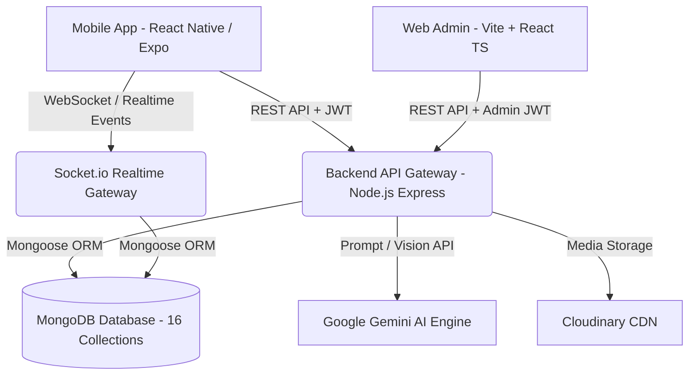
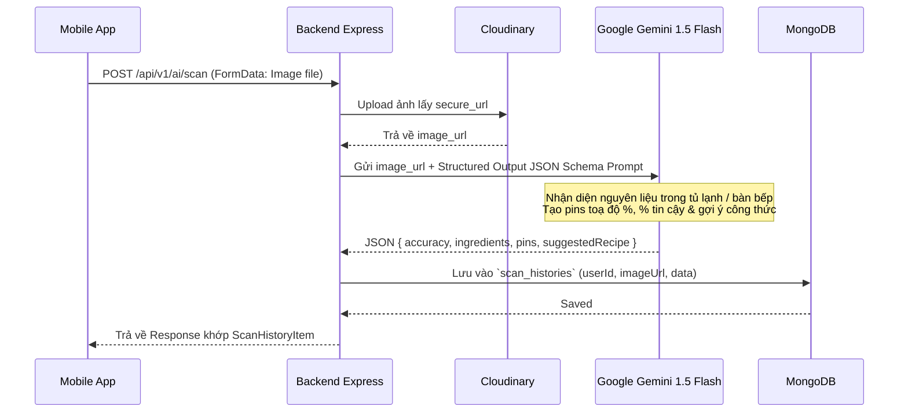
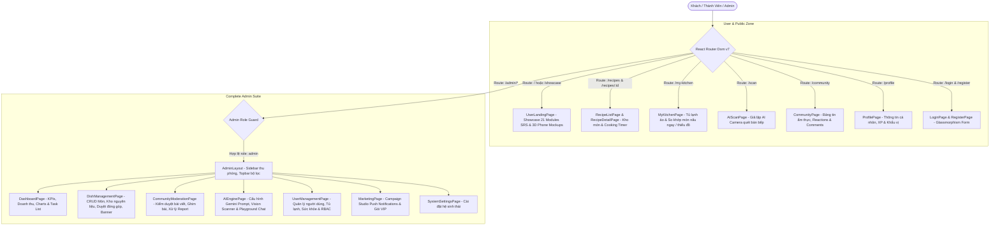
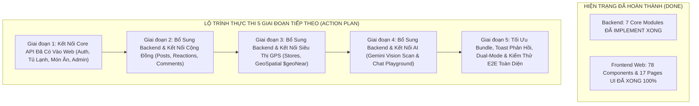

# Kế Hoạch Triển Khai Kiến Trúc Hệ Thống Backend & Web Admin - SmartCook Production Grade

> **Trạng thái:** Đã rà soát chuyên sâu 100% source code Frontend Mobile (`smartcook-mobile`), đối chiếu từng Interface, Service, Component và tài liệu SRS.
> **Mục tiêu:** Xây dựng hệ thống Backend chuẩn Production (`smartcook-backend`) và trang quản trị Web Admin Vite (`smartcook-web`) đáp ứng trọn vẹn mọi tính năng hiện tại của ứng dụng, đặc biệt là tính năng tích hợp AI và GPS.

---

## 1. Tổng Quan Hệ Sinh Thái Dự Án (Ecosystem Architecture)



- **Mobile Client (`smartcook-mobile`)**: React Native (Expo), TypeScript, Tailwind/NativeWind, Expo Router, Speech TTS tiếng Việt, Image Picker, Location GPS, Socket.io Client.
- **Backend Service (`smartcook-backend`)**: Node.js, Express.js, Socket.io (WebSocket), TypeScript, Mongoose ODM, MongoDB 7.0+, JWT Auth (Access + Refresh Token), Joi Validation, Cloudinary, Gemini AI SDK.
- **Web Admin Portal (`smartcook-web`)**: Vite + React, TypeScript, Tailwind CSS, TanStack Query, React Hook Form, Recharts.

---

## 2. Thiết Kế Cơ Sở Dữ Liệu Chi Tiết (16 MongoDB Schemas & Indexes)

Sau khi rà soát tỉ mỉ toàn bộ Frontend và tính năng Cộng Đồng & Chat Realtime mới, hệ thống chuẩn hoá **16 Collections** với kiểu dữ liệu chặt chẽ:

### 2.1. Nhóm Core & Người Dùng
#### 1. `users` Collection
Lưu trữ thông tin tài khoản, cấp bậc đầu bếp (XP), và khẩu vị cá nhân hoá.
- `_id`: `ObjectId`
- `email`: `String` (Unique, Trim, Lowercase, Indexed)
- `password`: `String` (Bcrypt hashed, `select: false` khi query thường)
- `firstName`: `String` (Từ màn Register)
- `lastName`: `String` (Từ màn Register)
- `fullName`: `String` (Virtual hoặc lưu trữ phục vụ hiển thị)
- `avatar`: `String` (URL Cloudinary)
- `role`: `String` (Enum: `['user', 'admin']`, Default: `'user'`)
- `chefExp`: `Number` (Kinh nghiệm XP tích luỹ từ việc nấu ăn, mặc định: 0, mỗi món hoàn thành +50 XP)
- `level`: `String` (Cấp bậc: "Tập sự", "Bếp gia đình", "Đầu bếp tài ba", "Bếp trưởng")
- `preferences`: `Object` (Khớp 100% với `UserPreferences` từ Onboarding Survey):
  - `hasCompletedSurvey`: `Boolean` (Default: false)
  - `portion`: `String` (Enum: `['1', '2', '3-4', '5+']`, Default: `'3-4'`)
  - `cuisines`: `[String]` (Vd: `['vietnamese', 'asian', 'healthy', 'western', 'quick', 'budget', 'vegetarian', 'dessert']`)
  - `healthGoal`: `String` (Enum: `['healthy', 'loss', 'muscle', 'budget']`, Default: `'healthy'`)
  - `restrictions`: `[String]` (Vd: `['no-spicy', 'peanut', 'seafood', 'lactose', 'vegetarian']`)
  - `tasteProfile`: `[String]` (Vd: `['dam-da', 'thanh-dam', 'cay-nong', 'ngot-thanh', 'chua-cay', 'beo-ngay']`)
  - `cookingTime`: `String` (Enum: `['quick', 'medium', 'standard', 'slow']`)
  - `updatedAt`: `Date`
- `favoriteRecipeIds`: `[{ type: ObjectId, ref: 'Recipe' }]`
- `refreshToken`: `String` (Lưu token hash hoặc whitelist để hỗ trợ Silent Refresh Token)
- `isActive`: `Boolean` (Default: true, Admin có thể khoá tài khoản)
- `createdAt`, `updatedAt`: `Date`
- **Indexes**: `{ email: 1 }` (Unique), `{ role: 1 }`

#### 2. `categories` Collection
Quản lý cây danh mục món ăn (dành cho Web Admin quản trị linh hoạt và Mobile filter).
- `_id`: `ObjectId`
- `name`: `String` (Vd: "Gia đình", "Nấu nhanh < 20p", "Healthy", "Tiết kiệm", "Trẻ em", "Ăn chay", "Món Việt", "Tráng miệng")
- `code`: `String` (Unique slug: `family`, `quick`, `healthy`, `budget`, `kids`, `vegetarian`, `vietnamese`, `dessert`)
- `color`: `String` (Mã màu HEX: `#FF6B35`, `#10B981`... đồng bộ Mobile `CATEGORIES`)
- `icon`: `String` (Tên icon Ionicons hoặc URL)
- `order`: `Number` (Thứ tự hiển thị trên thanh tabs)
- `isActive`: `Boolean` (Default: true)
- **Indexes**: `{ code: 1 }` (Unique), `{ order: 1 }`

---

### 2.2. Nhóm Nấu Ăn, Công Thức & Tủ Lạnh
#### 3. `ingredients` Collection (Thư viện nguyên liệu chuẩn)
Master Database gồm 14 nhóm nguyên liệu từ `FridgeView.tsx`.
- `_id`: `ObjectId`
- `name`: `String` (Vd: "Thịt gà", "Thịt thăn bò", "Cà chua bi", "Cá hồi phi lê", "Nước mắm")
- `normalizedName`: `String` (Tên không dấu viết thường để match nhanh: "thit ga", "thit than bo")
- `aliases`: `[String]` (Mảng từ đồng nghĩa khớp `KEYWORD_MAP` trên FE: `["ga", "dui ga", "uc ga", "canh ga"]`)
- `category`: `String` (Enum 14 nhóm: `meat`, `seafood`, `greens`, `veggies`, `herbs`, `fruits`, `egg_tofu`, `dairy`, `carbs`, `grain`, `seasoning`, `spice`, `sauces`, `dry`)
- `subCategory`: `String` (Vd: "Thịt gia cầm & heo", "Rau xanh các loại", "Dầu ăn & sốt nấu")
- `icon`: `String` (Icon name / MaterialCommunityIcons)
- `defaultUnit`: `String` (g, kg, ml, muỗng canh, quả, miếng)
- `averagePrice`: `Number` (Giá tham khảo vnđ để ước lượng giá tiền món ăn và giỏ hàng)
- **Indexes**: `{ normalizedName: 1 }`, `{ aliases: 1 }`, `{ category: 1 }`, Text Index trên `name` và `aliases`.

#### 4. `recipes` Collection (Trung tâm dữ liệu của ứng dụng)
Khớp 100% với Interface `Recipe` trong `recipe.ts` và `CreateRecipeModal.tsx`.
- `_id`: `ObjectId`
- `title`: `String` (Tên món ăn, vd: "Cơm Gà Teriyaki Áp Chảo")
- `author`: `String` (Tên tác giả hiển thị, vd: "Chef Gordon", "Minh Tuấn")
- `authorId`: `ObjectId` (Ref: `User`, null nếu là món hệ thống của Admin)
- `categoryCode`: `String` (Ref: `Category.code`, vd: "family", "healthy")
- `badge`: `String` (Tag nổi bật hiển thị trên thẻ card: "👨‍👩‍👧 Gia đình • 4 phần", "⭐ 4.9 • 30 phút")
- `sub`: `String` (Mô tả ngắn dòng phụ: "Đậm đà • Cả nhà thích")
- `description`: `String` (Mô tả chi tiết công thức)
- `image`: `String` (URL ảnh đại diện chất lượng cao)
- `minutes`: `Number` (Thời gian chế biến tổng cộng tính theo phút, vd: 25)
- `difficulty`: `String` (Enum: `['Dễ', 'Trung bình', 'Nâng cao']`)
- `servings`: `String` (Vd: "4 phần", "2 - 3 người")
- `servingsCount`: `Number` (Số khẩu phần chuẩn, phục vụ thuật toán Scaler co giãn nguyên liệu)
- `price`: `String` (Hiển thị ước tính: "~65.000đ")
- `costEstimation`: `Number` (Giá tiền số nguyên vnđ: 65000)
- `calories`: `Number` (Tổng calories mỗi khẩu phần, vd: 450)
- `rating`: `Number` (Trung bình sao đánh giá: 1.0 - 5.0, Default: 5.0)
- `reviewCount`: `Number` (Số lượng lượt đánh giá, Default: 0)
- `tags`: `[String]` (Tags tìm kiếm: `['hot', 'popular', 'new', 'dinner', 'chicken']`)
- `ingredients`: `[Object]` (Khớp `RecipeIngredient`):
  - `ingredientId`: `ObjectId` (Ref: `Ingredient`, optional)
  - `name`: `String` (Vd: "Thịt đùi gà phi lê")
  - `amount`: `String` (Vd: "400g", "2 muỗng canh", "1/2 củ")
  - `baseQuantity`: `Number` (Định lượng số cho 1 phần ăn để nhân tỷ lệ scaler)
  - `unit`: `String` (g, ml, quả, muỗng)
  - `icon`: `String` (Tên icon đại diện)
- `steps`: `[Object]` (Khớp `RecipeStep` - Chuyên dùng cho Cooking Mode):
  - `stepNumber`: `Number` (1, 2, 3...)
  - `title`: `String` (Tiêu đề bước: "Sơ chế gà", "Làm sốt Teriyaki")
  - `description`: `String` (Hướng dẫn chi tiết, được TTS giọng nói AI đọc)
  - `timerMinutes`: `Number` (Số phút hẹn giờ cho bước này, optional)
  - `tip`: `String` (Mẹo đầu bếp chuyên gia cho bước này)
- `nutrition`: `Object` (Khớp `RecipeNutrition`):
  - `calories`: `Number`
  - `protein`: `String` (Vd: "35g")
  - `carbs`: `String` (Vd: "45g")
  - `fat`: `String` (Vd: "14g")
  - `fiber`: `String` (Vd: "5g")
  - `sodium`: `String` (Vd: "680mg")
  - `advice`: `String` (Lời khuyên dinh dưỡng từ chuyên gia)
- `status`: `String` (Enum: `['published', 'pending_approval', 'draft']`, Default: `'published'`)
- `createdAt`, `updatedAt`: `Date`
- **Indexes**: 
  - Compound Index: `{ categoryCode: 1, difficulty: 1, calories: 1 }`
  - Text Index: `{ title: "text", description: "text", tags: "text" }`
  - `{ rating: -1 }`, `{ reviewCount: -1 }`, `{ status: 1 }`

#### 5. `user_fridges` Collection (Kho Tủ Lạnh Thông Minh Cá Nhân - MỚI RÀ SOÁT)
Lưu danh sách nguyên liệu người dùng đang có trong tủ lạnh (Từ tab `FridgeView.tsx`).
- `_id`: `ObjectId`
- `userId`: `ObjectId` (Ref: `User`, Indexed)
- `ingredientName`: `String` (Tên nguyên liệu, vd: "Thịt gà", "Nước tương", "Mật ong")
- `normalizedName`: `String` (Chuẩn hoá không dấu: "thit ga", "nuoc tuong")
- `category`: `String` (Nhóm: meat, veggies, sauces...)
- `quantity`: `String` (Optional, vd: "500g", "2 hộp")
- `addedAt`: `Date` (Default: Date.now)
- `isCustom`: `Boolean` (Người dùng gõ tay thêm vào hay chọn từ danh mục chuẩn)
- **Indexes**: `{ userId: 1, normalizedName: 1 }` (Unique tránh trùng)

---

### 2.3. Nhóm AI & Tương Tác Trải Nghiệm
#### 6. `scan_histories` Collection (Lịch Sử Quét AI Camera / Tủ Lạnh)
Khớp 100% cấu trúc `ScanHistoryItem` từ `scanHistoryService.ts` & `ScanAIView.tsx`.
- `_id`: `ObjectId`
- `userId`: `ObjectId` (Ref: `User`, Indexed)
- `title`: `String` (Vd: "Bàn bếp chuẩn bị trưa nay", "Ngăn mát tủ lạnh sáng nay")
- `imageUrl`: `String` (URL ảnh chụp/tải lên từ Cloudinary)
- `scannedAt`: `Date` (Thời gian quét)
- `accuracy`: `Number` (Độ chính xác nhận diện tổng quan: 90 - 99%)
- `ingredients`: `[Object]` (Khớp `ScanDetectedIngredient`):
  - `name`: `String` (Vd: "Thịt ức gà", "Cà chua bi", "Quả bơ sáp")
  - `confidence`: `String` (Vd: "98%", "96%")
  - `icon`: `String` (Icon hiển thị: "food-drumstick", "fruit-cherries")
- `pins`: `[Object]` (Khớp `ScanPin` - Toạ độ ghim nhãn nhận diện trên ảnh):
  - `text`: `String` (Vd: "🍗 Ức gà (98%)")
  - `top`: `Number` (Toạ độ %)
  - `bottom`: `Number` (Toạ độ %)
  - `left`: `Number` (Toạ độ %)
  - `right`: `Number` (Toạ độ %)
- `suggestedRecipe`: `Object` (Khớp `ScanSuggestedRecipe` - Món ăn AI gợi ý tối ưu):
  - `recipeId`: `ObjectId` (Ref: `Recipe`, optional)
  - `title`: `String` (Vd: "Salad Ức Gà Bơ Sáp Sốt Chanh Leo")
  - `desc`: `String` (Lý do gợi ý từ 100% nguyên liệu quét được)
  - `calories`: `Number`
  - `durationMinutes`: `Number`
  - `matchPercent`: `Number` (Vd: 95%, 100%)
- **Indexes**: `{ userId: 1, scannedAt: -1 }`

#### 7. `cooking_histories` Collection (Nhật Ký Nấu Ăn & XP Gamification)
Khớp 100% cấu trúc `CookingHistoryItem` từ `cookingHistoryService.ts` & `cooking-mode.tsx`.
- `_id`: `ObjectId`
- `userId`: `ObjectId` (Ref: `User`, Indexed)
- `recipeId`: `ObjectId` (Ref: `Recipe`, Indexed)
- `recipeName`: `String` (Tên món ăn đã nấu)
- `image`: `String` (URL ảnh món ăn)
- `cookedAt`: `Date` (Thời gian hoàn thành)
- `durationMinutes`: `Number` (Thời gian người dùng nấu thực tế, vd: 25)
- `servings`: `Number` (Số phần đã nấu, vd: 3)
- `usedIngredients`: `[String]` (Danh sách nguyên liệu đã tích chọn sử dụng)
- `calories`: `Number` (Lượng calo đã nạp)
- `rating`: `Number` (Số sao đánh giá nhanh sau khi nấu: 1 - 5)
- `xpEarned`: `Number` (Điểm kinh nghiệm nhận được, vd: 50)
- `completedPhotoUrl`: `String` (Ảnh chụp thành phẩm người dùng chụp chia sẻ)
- **Indexes**: `{ userId: 1, cookedAt: -1 }`

#### 8. `reviews` Collection (Đánh Giá & Nhận Xét Món Ăn)
- `_id`: `ObjectId`
- `recipeId`: `ObjectId` (Ref: `Recipe`, Indexed)
- `userId`: `ObjectId` (Ref: `User`)
- `rating`: `Number` (1 - 5 sao, bắt buộc)
- `comment`: `String` (Nội dung nhận xét)
- `images`: `[String]` (Ảnh feedback món ăn của người dùng)
- `likesCount`: `Number` (Default: 0)
- `createdAt`: `Date`
- **Indexes**: `{ recipeId: 1, createdAt: -1 }`, `{ userId: 1 }`

---

### 2.4. Nhóm Kế Hoạch, Giỏ Hàng & Định Vị Siêu Thị
#### 9. `meal_plans` Collection (Lập Kế Hoạch Bữa Ăn Theo Tuần)
Khớp cấu trúc lịch ăn 7 ngày từ `PlannerView.tsx`.
- `_id`: `ObjectId`
- `userId`: `ObjectId` (Ref: `User`, Indexed)
- `weekStartDate`: `Date` (Ngày đầu tuần - Thứ 2)
- `days`: `[Object]` (7 ngày: Thứ 2 -> Chủ Nhật):
  - `dayOfWeek`: `String` (Vd: "Thứ 2", "Thứ 3"...)
  - `date`: `String` (Vd: "2026-09-17")
  - `meals`: `[Object]`:
    - `slot`: `String` (Enum: `['Bữa Sáng', 'Bữa Trưa', 'Bữa Tối', 'Bữa Phụ']`)
    - `time`: `String` (Vd: "07:00", "12:00", "19:00")
    - `recipeId`: `ObjectId` (Ref: `Recipe`)
    - `calories`: `Number`
    - `isCooked`: `Boolean` (Default: false)
- **Indexes**: `{ userId: 1, weekStartDate: 1 }` (Unique per user/week)

#### 10. `cart_items` Collection (Danh Sách Mua Sắm & Đi Chợ)
Khớp 100% cấu trúc `CartItem` từ `cartService.ts` và danh sách đi chợ trong `PlannerView.tsx`.
- `_id`: `ObjectId`
- `userId`: `ObjectId` (Ref: `User`, Indexed)
- `name`: `String` (Tên nguyên liệu cần mua, vd: "Thịt thăn bò Tenderloin")
- `amount`: `String` (Định lượng: "500g", "1 vỉ")
- `price`: `Number` (Giá dự kiến: 85000)
- `recipeTitle`: `String` (Ghi chú mua cho món ăn nào, vd: "Bò Bít Tết Sốt Tiêu")
- `recipeId`: `ObjectId` (Ref: `Recipe`, optional)
- `bought`: `Boolean` (Đã mua hay chưa, Default: false)
- `category`: `String` (Vd: "Thịt & Cá", "Rau củ", "Bơ & Gia vị")
- `addedAt`: `Date` (Default: Date.now)
- **Indexes**: `{ userId: 1, bought: 1 }`

#### 11. `stores` Collection (Chuỗi Siêu Thị & Cửa Hàng Tiện Lợi - GeoSpatial)
Khớp 100% cấu trúc `Store` từ `mockStores.ts` & `storeService.ts`. Thay thế hardcode trên FE bằng Geo Query MongoDB.
- `_id`: `ObjectId`
- `name`: `String` (Vd: "WinMart+ Nguyễn Thị Minh Khai", "Co.opmart Cống Quỳnh")
- `brand`: `String` (WinMart, Co.opmart, Tops Market, Bách Hóa Xanh, Emart, Lotte Mart, Big C...)
- `address`: `String` (Vd: "123 Nguyễn Thị Minh Khai, P. Bến Thành, Quận 1, TP.HCM")
- `openHours`: `String` (Vd: "06:00 - 22:00")
- `phone`: `String` (Vd: "028 7108 1368")
- `logo`: `String` (URL logo chuỗi siêu thị)
- `location`: `Object` (GeoJSON Point bắt buộc cho MongoDB 2dsphere):
  - `type`: `String` (Luôn là `"Point"`)
  - `coordinates`: `[Number]` (`[longitude, latitude]` chuẩn GeoJSON - vd: `[106.6909, 10.7769]`)
- `isActive`: `Boolean` (Default: true)
- **Indexes**: **`{ location: "2dsphere" }`** (Chỉ mục không gian địa lý phục vụ toán tử `$near` / `$geoNear` tính khoảng cách tức thì theo mét/km)

#### 12. `notifications` Collection (Thông Báo Ứng Dụng)
- `_id`: `ObjectId`
- `userId`: `ObjectId` (Ref: `User`, Indexed)
- `title`: `String` (Vd: "Đến giờ chuẩn bị bữa tối!", "Nhắc nhở đi chợ")
- `body`: `String` (Nội dung thông báo)
- `type`: `String` (Enum: `['meal_reminder', 'cooking_timer', 'shopping_reminder', 'community', 'system']`)
- `data`: `Object` (Chứa `recipeId`, `postId`, `conversationId` điều hướng)
- `isRead`: `Boolean` (Default: false)
- `createdAt`: `Date` (TTL Index tự xoá sau 30 ngày)
- **Indexes**: `{ userId: 1, isRead: 1 }`, `{ createdAt: 1 }` (ExpireAfterSeconds: 2592000)

---

### 2.5. Nhóm Cộng Đồng & Chat Realtime (Socket.io)
#### 13. `posts` Collection (Bài Đăng Chia Sẻ Món Ăn, Cảm Xúc Đa Dạng & Share Bài)
- `_id`: `ObjectId`
- `author`: `ObjectId` (Ref: `User`, Indexed, Required)
- `caption`: `String` (Nội dung chia sẻ, kinh nghiệm, mẹo vặt, thành quả nấu)
- `images`: `[{ url: String, publicId: String }]` (Ảnh món ăn upload Cloudinary, hỗ trợ nhiều ảnh)
- `recipe`: `ObjectId` (Ref: `Recipe`, optional - liên kết công thức nếu bài viết làm từ công thức có sẵn)
- `tags`: `[String]` (Vd: `['monngonmoingay', 'healthy', 'nauandongian']`)
- `reactions`: `[Object]` (Chi tiết danh sách cảm xúc của từng thành viên):
  - `user`: `ObjectId` (Ref: `User`, Indexed)
  - `type`: `String` (Enum: `['like', 'love', 'haha', 'wow', 'sad', 'angry']`)
  - `createdAt`: `Date` (Default: Date.now)
- `reactionCounts`: `Object` (Bộ đếm cached tối ưu hiển thị nhanh icon và số lượng từng loại cảm xúc):
  - `like`: `Number` (Default: 0 - Thích)
  - `love`: `Number` (Default: 0 - Yêu thích / Thả tim)
  - `haha`: `Number` (Default: 0 - Cười vui / Haha)
  - `wow`: `Number` (Default: 0 - Trầm trồ / Wow)
  - `sad`: `Number` (Default: 0 - Buồn / Chia buồn)
  - `angry`: `Number` (Default: 0 - Giận dữ / Phẫn nộ)
- `totalReactions`: `Number` (Tổng số cảm xúc = like + love + haha + wow + sad + angry, Default: 0)
- `commentsCount`: `Number` (Default: 0)
- `sharesCount`: `Number` (Default: 0 - Số lượt chia sẻ bài viết)
- `sharedPost`: `ObjectId` (Ref: `Post`, optional - ID bài viết gốc nếu đây là bài viết được share lại)
- `isPinned`: `Boolean` (Default: false)
- `createdAt`, `updatedAt`: `Date`
- **Indexes**: `{ createdAt: -1 }`, `{ author: 1, createdAt: -1 }`, `{ totalReactions: -1 }`, `{ 'reactions.user': 1 }`

#### 14. `comments` Collection (Bình Luận Bài Viết)
- `_id`: `ObjectId`
- `post`: `ObjectId` (Ref: `Post`, Indexed, Required)
- `author`: `ObjectId` (Ref: `User`, Required)
- `content`: `String` (Nội dung bình luận)
- `parentComment`: `ObjectId` (Ref: `Comment`, optional - hỗ trợ reply comment nhiều cấp)
- `reactions`: `[Object]` (Thả cảm xúc bình luận):
  - `user`: `ObjectId` (Ref: `User`)
  - `type`: `String` (Enum: `['like', 'love', 'haha', 'wow', 'sad', 'angry']`)
- `totalReactions`: `Number` (Default: 0)
- `createdAt`, `updatedAt`: `Date`
- **Indexes**: `{ post: 1, createdAt: 1 }`, `{ post: 1, parentComment: 1 }`

#### 15. `conversations` Collection (Cuộc Trò Chuyện Chat)
- `_id`: `ObjectId`
- `participants`: `[{ type: ObjectId, ref: 'User' }]` (Mảng 2 userId cho chat 1-1, hoặc nhiều hơn)
- `lastMessage`: `Object` (Phục vụ hiển thị danh sách hội thoại không cần scan table messages):
  - `sender`: `ObjectId` (Ref: `User`)
  - `text`: `String`
  - `mediaUrl`: `String`
  - `createdAt`: `Date`
- `unreadCounts`: `Map<String, Number>` (Key là `userId.toString()`, Value là số tin chưa đọc)
- `createdAt`, `updatedAt`: `Date`
- **Indexes**: `{ participants: 1 }`, `{ updatedAt: -1 }`

#### 16. `messages` Collection (Tin Nhắn Chat Realtime)
- `_id`: `ObjectId`
- `conversation`: `ObjectId` (Ref: `Conversation`, Indexed, Required)
- `sender`: `ObjectId` (Ref: `User`, Indexed, Required)
- `text`: `String` (Nội dung tin nhắn)
- `mediaUrl`: `String` (Ảnh chụp món ăn gửi kèm trực tiếp trong đoạn chat)
- `isRead`: `Boolean` (Default: false)
- `createdAt`, `updatedAt`: `Date`
- **Indexes**: `{ conversation: 1, createdAt: -1 }` (Tối ưu tải lịch sử tin nhắn lùi phân trang)

---

## 3. Kiến Trúc Tích Hợp Trí Tuệ Nhân Tạo (AI Engine Integration)

Người dùng đặc biệt yêu cầu tích hợp AI. SmartCook sẽ tích hợp **Google Gemini 1.5 Flash API** (tối ưu chi phí, độ trễ cực thấp < 1.5s và khả năng Multimodal Vision xuất sắc):



### Các Luồng AI Được Thiết Kế Chuyên Biệt:
1. **AI Fridge & Tabletop Vision Scanner (`/api/v1/ai/scan`)**:
   - Nhận ảnh từ Camera hoặc Thư viện ảnh của người dùng.
   - Sử dụng Gemini Vision với `responseSchema` ép kiểu JSON trả về: danh sách nguyên liệu (`name`, `confidence`), toạ độ ghim nhãn (`pins: {text, top, left, right, bottom}`), và món ăn sáng tạo tối ưu nhất không cần mua thêm (`suggestedRecipe`).
2. **AI Smart Recipe Generator (`/api/v1/ai/generate-recipe`)**:
   - Người dùng tick chọn những gì còn lại trong tủ lạnh (`FridgeView`).
   - AI sinh công thức món ăn mới theo khẩu vị (`tasteProfile`), mục tiêu (`healthGoal`), và thời gian nấu (`cookingTime`).
3. **AI Nutrition Advisor (`/api/v1/ai/analyze-nutrition`)**:
   - Tự động bóc tách và phân tích Calo, Protein, Carbs, Fat từ danh sách nguyên liệu công thức mới người dùng nhập vào.

---

## 4. Kiến Trúc Backend Node.js & Cấu Trúc Mã Nguồn (N-Tier Architecture)

Backend sẽ tuân thủ nghiêm ngặt mô hình nhiều tầng để đảm bảo tính module hoá, dễ test và scale:

```text
smartcook-backend/
├── src/
│   ├── config/             # DB Connection (MongoDB), Cloudinary, Gemini AI client, JWT config
│   ├── constants/          # HTTP Status, Error Codes, Regex, Default Preferences
│   ├── models/             # 16 Mongoose Schemas & TypeScript Interfaces
│   │   ├── User.ts
│   │   ├── Category.ts
│   │   ├── Ingredient.ts
│   │   ├── Recipe.ts
│   │   ├── UserFridge.ts
│   │   ├── Post.ts             # Bài đăng cộng đồng
│   │   ├── Comment.ts          # Bình luận
│   │   ├── Conversation.ts     # Cuộc trò chuyện chat
│   │   ├── Message.ts          # Tin nhắn realtime
│   │   ├── ScanHistory.ts
│   │   ├── CookingHistory.ts
│   │   ├── Review.ts
│   │   ├── MealPlan.ts
│   │   ├── CartItem.ts
│   │   ├── Store.ts
│   │   └── Notification.ts
│   ├── repositories/       # Tầng tương tác CSDL trực tiếp (Tách biệt khỏi logic nghiệp vụ)
│   ├── services/           # Business Logic:
│   │   ├── auth.service.ts
│   │   ├── admin.service.ts      # Thống kê Dashboard, Quản lý thành viên (Admin Portal)
│   │   ├── user.service.ts
│   │   ├── recipe.service.ts
│   │   ├── fridge.service.ts     # Thuật toán tính % khớp tủ lạnh (Fridge Match Ranking)
│   │   ├── community.service.ts  # Bài đăng cộng đồng, comments, likes
│   │   ├── chat.service.ts       # Lịch sử hội thoại, tin nhắn
│   │   ├── ai.service.ts         # Gemini Multimodal API calls & Prompting
│   │   ├── planner.service.ts
│   │   ├── cart.service.ts
│   │   └── store.service.ts      # GeoSpatial queries ($geoNear)
│   ├── socket/             # Socket.io Realtime Gateway:
│   │   ├── index.ts              # Khởi tạo Socket.io Server, quản lý kết nối
│   │   ├── socketAuth.ts         # Middleware xác thực JWT token qua handshake
│   │   ├── chat.handler.ts       # Xử lý sự kiện phòng chat, gửi/nhận tin nhắn, typing
│   │   └── community.handler.ts  # Broadcast thông báo like/comment mới theo realtime
│   ├── controllers/        # Điều hướng Request/Response (auth, admin, recipe, community, fridge...)
│   ├── routes/             # API Endpoints (/api/v1/auth, /admin, /recipes, /posts, /fridge...)
│   ├── middlewares/        # AuthGuard (JWT), RoleGuard (Admin), Upload (Multer+Cloudinary), Validation (Joi), ErrorHandler, RateLimiter
│   ├── utils/              # Helper: Token generation, Password hashing, Logger (Winston/Morgan)
│   └── app.ts / server.ts  # Khởi chạy Express Server + Socket.io Server
├── .env.example
├── tsconfig.json
└── package.json
```

---

## 5. Thiết Kế Hệ Thống Website & Web Admin Đa Năng (`smartcook-web` - Hybrid All-in-One Architecture)

Dự án áp dụng mô hình **Hybrid All-in-One (Public Showcase & User Web App + Complete Admin Suite)** trong cùng một codebase `smartcook-web`, hiện đã hoàn thành 100% giao diện (UI/UX) và sẵn sàng tích hợp API kết nối trực tiếp đến hệ thống Backend (`smartcook-backend`).

### 5.1. Tech Stack & Thư Viện Sử Dụng
- **Core Framework**: React 19 + Vite 8 + TypeScript (Tốc độ HMR mili-giây, bundle tối ưu, hỗ trợ strict typing).
- **Styling & UI Effects**: Tailwind CSS v4 (`@tailwindcss/vite`) + Font Inter & Outfit + Glassmorphism effects + Lucide React Icons.
- **State Management & Network**:
  - `zustand`: Quản lý Auth State (`useAuthStore`), Cart State (`useCartStore`), và Admin Mock State (`useAdminStore`).
  - `axios`: Cấu hình Base Instance, Interceptors tự động đính kèm `Bearer <token>` và cơ chế **Silent Refresh Token** khi gặp lỗi 401 (`POST /auth/refresh-token`).
  - `@tanstack/react-query`: Quản lý server state, cache dữ liệu tự động, revalidate và hỗ trợ phân trang/infinite query.
  - `@react-oauth/google`: Đăng nhập Google One-Tap và nút "Sign in with Google" đồng bộ với endpoint `POST /auth/google`.
  - `recharts`: Vẽ biểu đồ phân tích số liệu Dashboard chuyên nghiệp (LineChart người dùng, BarChart món ăn, PieChart dinh dưỡng, Doanh thu).
  - `HTML5 Geolocation & Google Maps URL API`: Định vị siêu thị lân cận và chỉ đường bản đồ.

---

### 5.2. Kiến Trúc Phân Vùng Giao Diện Đã Triển Khai (Actual Dual-Zone Architecture)



#### Phân Vùng 1: User Experience & Public Web App (Đã Hoàn Thành UI 100%)
1. **Trang Giới Thiệu Tương Tác ([UserLandingPage.tsx](file:///e:/FPTU/Term07/project/smartcook-web/src/pages/user/UserLandingPage.tsx))**:
   - Showcase toàn diện **21 modules của SmartCook SRS** kết hợp hình ảnh 3D mockup điện thoại chân thực cho từng tính năng.
   - Bảng so sánh trước/sau khi dùng ứng dụng, số liệu thống kê tin cậy, FAQ và QR code tải app mobile.
2. **Thanh Header Đa Năng ([UserHeader.tsx](file:///e:/FPTU/Term07/project/smartcook-web/src/components/user/UserHeader.tsx))**:
   - Tích hợp thanh banner nhắc nhở giỏ hàng thông minh khi có nguyên liệu cần mua.
   - Cấp bậc đầu bếp (XP), ngọn lửa XP, level và avatar cá nhân hóa.
3. **Trang "Bếp Của Tôi" ([MyKitchenPage.tsx](file:///e:/FPTU/Term07/project/smartcook-web/src/pages/user/MyKitchenPage.tsx))**:
   - Quản lý tủ lạnh thông minh: phân loại 3 nhóm (Thịt/Hải sản, Rau củ, Gia vị/Tinh bột).
   - Thuật toán so khớp nguyên liệu: Lọc các món **"Nấu được ngay"** (đủ 100% nguyên liệu) và các món **"Thiếu 1-2 nguyên liệu"**.
   - Nút đẩy nguyên liệu thiếu vào Giỏ đi chợ hoặc mở Modal tìm siêu thị gần nhất.
4. **Modal Định Vị Siêu Thị Lân Cận ([NearbySupermarketsModal.tsx](file:///e:/FPTU/Term07/project/smartcook-web/src/components/supermarket/NearbySupermarketsModal.tsx))**:
   - Định vị GPS tìm các chuỗi siêu thị (WinMart, Co.opmart, Bách Hóa Xanh, Lotte, AEON...).
   - Tính khoảng cách km, giờ mở cửa, số hotline, nút chỉ đường Google Maps kèm danh sách nguyên liệu cần mua.
5. **Giỏ Đi Chợ Thông Minh ([GroceryCartDrawer.tsx](file:///e:/FPTU/Term07/project/smartcook-web/src/components/user/GroceryCartDrawer.tsx) & [useCartStore.ts](file:///e:/FPTU/Term07/project/smartcook-web/src/store/useCartStore.ts))**:
   - Drawer giỏ hàng trượt từ cạnh phải, tự động lưu `localStorage`.
   - Tính tổng chi phí ước tính (VNĐ) dựa trên giá thị trường chuẩn Việt Nam.
6. **Mô Phỏng Quét Ảnh AI ([AIScanPage.tsx](file:///e:/FPTU/Term07/project/smartcook-web/src/pages/user/AIScanPage.tsx))**:
   - Giả lập camera AI nhận diện nguyên liệu có bounding box và hướng dẫn cài đặt app mobile.
7. **Kho Món Ăn & Chi Tiết Công Thức ([RecipeListPage.tsx](file:///e:/FPTU/Term07/project/smartcook-web/src/pages/public/RecipeListPage.tsx) & [RecipeDetailPage.tsx](file:///e:/FPTU/Term07/project/smartcook-web/src/pages/public/RecipeDetailPage.tsx))**:
   - Danh sách món ăn đa dạng (Cơm đùi gà trứng ốp, Thịt kho tàu...), lọc theo danh mục, độ khó, thời gian.
   - Trang chi tiết có bộ đếm giờ (Cooking Timer), bảng calo dinh dưỡng, ước tính chi phí và nút thêm nhanh nguyên liệu vào giỏ đi chợ.
8. **Mạng Xã Hội Ẩm Thực ([CommunityPage.tsx](file:///e:/FPTU/Term07/project/smartcook-web/src/pages/public/CommunityPage.tsx))**:
   - Bảng tin bài đăng chia sẻ món ăn, thả 6 loại cảm xúc (`like`, `love`, `haha`, `wow`, `sad`, `angry`), bình luận và chia sẻ.

#### Phân Vùng 2: Phân Hệ Quản Trị Hệ Thống Toàn Diện (Admin Suite - Đã Hoàn Thành UI 100%)
1. **Khung Quản Trị ([AdminLayout.tsx](file:///e:/FPTU/Term07/project/smartcook-web/src/layouts/AdminLayout.tsx))**:
   - Sidebar cố định sát mép màn hình, hỗ trợ thu hẹp/mở rộng (`collapsed`).
   - Topbar tích hợp bộ lọc nâng cao theo phạm vi dữ liệu, trạng thái và mốc thời gian.
2. **Dashboard Thống Kê ([DashboardPage.tsx](file:///e:/FPTU/Term07/project/smartcook-web/src/pages/admin/DashboardPage.tsx))**:
   - KPIs người dùng và tài chính (Doanh thu thực tế, mục tiêu tháng, % đạt được).
   - Biểu đồ tăng trưởng người dùng mới (LineChart) và Top món ăn nấu nhiều nhất (BarChart).
   - Danh sách công việc quản trị cần xử lý (Task list).
3. **Quản Lý Món Ăn & Kho Nguyên Liệu ([DishManagementPage.tsx](file:///e:/FPTU/Term07/project/smartcook-web/src/pages/admin/DishManagementPage.tsx))**:
   - **Tab Món ăn**: Lọc theo danh mục, phân khúc giá (<20k, 20-50k, >50k), Modal Thêm/Sửa công thức đầy đủ trường (nguyên liệu, các bước nấu có timer, macro Protein/Carb/Fat/Fiber).
   - **Tab Kho nguyên liệu**: Quản lý 14 nhóm nguyên liệu, hạn dùng (shelf-life), từ đồng nghĩa (synonyms) cho AI.
   - **Tab Duyệt đóng góp**: Phê duyệt hoặc từ chối công thức từ cộng đồng người dùng.
   - **Tab Banner**: Cấu hình món ăn nổi bật hiển thị trên Hero Banner của Mobile.
4. **Kiểm Duyệt Cộng Đồng ([CommunityModerationPage.tsx](file:///e:/FPTU/Term07/project/smartcook-web/src/pages/admin/CommunityModerationPage.tsx))**:
   - Quản lý danh sách bài viết, ghim bài nổi bật (`isPinned`), ẩn bài, gắn nhãn spam.
   - Hộp thư xử lý báo cáo vi phạm (Spam, nội dung phản cảm, sai món).
5. **Người Dùng & Phân Quyền ([UserManagementPage.tsx](file:///e:/FPTU/Term07/project/smartcook-web/src/pages/admin/UserManagementPage.tsx))**:
   - Danh sách tài khoản: Xem chi tiết số món trong tủ lạnh, đồ sắp hết hạn, lịch sử nấu ăn, mục tiêu sức khỏe, dị ứng.
   - Khóa/Mở tài khoản (`active`, `suspended`, `banned`), nâng cấp gói VIP, phân quyền nhân sự (RBAC).
6. **Cấu Hình Trí Tuệ Nhân Tạo ([AIEnginePage.tsx](file:///e:/FPTU/Term07/project/smartcook-web/src/pages/admin/AIEnginePage.tsx))**:
   - Tinh chỉnh System Prompt, Temperature, chọn mô hình (Gemini 2.5 Flash, Gemini 1.5 Pro).
   - Điều chỉnh ngưỡng nhận diện AI Vision Scanner, xem nhật ký quét ảnh gần đây.
   - Hộp chat thử nghiệm phản hồi AI (Live Playground) ngay trên trang.
7. **Thông Báo & Marketing ([MarketingPage.tsx](file:///e:/FPTU/Term07/project/smartcook-web/src/pages/admin/MarketingPage.tsx))**:
   - Campaign Studio: Thiết kế và lên lịch gửi Push Notification tới Mobile (gợi ý bữa trưa, bữa tối, khuyến mãi).
   - Quản lý bảng giá gói thành viên VIP Premium.
8. **Cài Đặt Hệ Thống ([SystemSettingsPage.tsx](file:///e:/FPTU/Term07/project/smartcook-web/src/pages/admin/SystemSettingsPage.tsx))**: Cấu hình chung hệ sinh thái.

---

### 5.3. Cấu Trúc Thư Mục Thực Tế Dự Án `smartcook-web`

```text
smartcook-web/
├── public/                     # Favicon, 3D app screens, mockups, banners
│   ├── app-screens/            # Hình ảnh mockup 3D screens của app mobile
│   └── ...
├── src/
│   ├── api/                    # Tầng giao tiếp mạng Axios & API Endpoints
│   │   ├── client.ts           # ✅ Axios instance, Bearer Token, Silent Refresh Token logic
│   │   ├── auth.api.ts         # ✅ Login, Register, Google Auth GIS, Me, Survey, Refresh Token
│   │   ├── recipe.api.ts       # ✅ CRUD Recipes, Filter, Favorites, Fridge Match
│   │   ├── fridge.api.ts       # ✅ Quản lý tủ lạnh cá nhân GET/POST/PUT/DELETE
│   │   ├── ingredient.api.ts   # ✅ Categories & 14 nhóm nguyên liệu chuẩn
│   │   ├── cookingHistory.api.ts # ✅ Ghi nhận hoàn thành nấu ăn (+50 XP) & xem lịch sử
│   │   ├── admin.api.ts        # ✅ Dashboard KPIs, Users, Moderation, Status Toggle
│   │   ├── store.api.ts        # [Kế hoạch Giai đoạn 3] Siêu thị đối tác & GeoSpatial GPS
│   │   └── community.api.ts    # [Kế hoạch Giai đoạn 2] Posts, Reactions, Comments, Share
│   ├── components/
│   │   ├── chat/               # ✅ [MỚI BỔ SUNG] CulinaryChatModal.tsx (Phòng chat ẩm thực & AI Lounge)
│   │   ├── supermarket/        # NearbySupermarketsModal.tsx (GPS Siêu thị gần nhất)
│   │   └── user/               # ✅ UserHeader.tsx (Menu "Nguyên Liệu", Giỏ cách ly, Chat), GroceryCartDrawer.tsx, RealisticPhoneFrame.tsx
│   ├── layouts/
│   │   ├── AdminLayout.tsx     # Sidebar thu phóng, Topbar bộ lọc nâng cao
│   │   ├── AuthLayout.tsx      # Khung đăng nhập, đăng ký Glassmorphism
│   │   └── PublicLayout.tsx    # Khung public dự phòng
│   ├── pages/
│   │   ├── admin/              # DashboardPage, DishManagementPage, CommunityModerationPage,
│   │   │                       # UserManagementPage, AIEnginePage, MarketingPage, SystemSettingsPage
│   │   ├── auth/               # ✅ LoginPage (Google GIS, Ẩn/Hiện pass), RegisterPage (Xác nhận pass, Ẩn/Hiện pass)
│   │   ├── public/             # RecipeListPage, RecipeDetailPage (✅ Chuẩn hóa phòng vệ), CommunityPage (✅ Redesign Feed & Chat Lounge)
│   │   └── user/               # UserLandingPage, MyKitchenPage, AIScanPage, ProfilePage
│   ├── routes/
│   │   └── AppRoutes.tsx       # Định tuyến React Router v7, ProtectedUserRoute, AdminGuard
│   ├── store/
│   │   ├── useAuthStore.ts     # Quản lý User, JWT Token, Role, Logout
│   │   ├── useCartStore.ts     # ✅ Quản lý Giỏ Đi Chợ Thông Minh cách ly theo từng User (smartcook_cart_<userId>)
│   │   ├── useChatStore.ts     # ✅ [MỚI BỔ SUNG] Quản lý trạng thái phòng chat ẩm thực, tin nhắn realtime
│   │   └── useAdminStore.ts    # Quản lý State & Mock Data hoàn chỉnh cho Admin Suite
│   ├── types/
│   │   ├── index.ts            # User, Recipe, Post, ApiResponse DTOs
│   │   └── admin.ts            # Toàn bộ Types chi tiết cho Admin Suite & SRS Modules
│   ├── App.tsx
│   ├── main.tsx
│   └── index.css               # Tailwind directives, font config, custom scrollbar
├── package.json
├── tsconfig.json
└── vite.config.ts
```

---

### 5.4. Bảng Ánh Xạ Tích Hợp API Backend ➔ Frontend Web (API Integration Matrix)

Dưới đây là ma trận ánh xạ toàn bộ màn hình UI sang các Endpoints Backend và trạng thái thực thi:

| Màn Hình Trên Web | Tính Năng / Hành Động | Backend API Endpoint | Method | Trạng Thái Thực Tế Hiện Tại |
| :--- | :--- | :--- | :--- | :--- |
| `LoginPage`, `RegisterPage` | Đăng nhập tài khoản thật | `/api/v1/auth/login` | POST | ✅ ĐÃ TÍCH HỢP & HOÀN TẤT (Giai đoạn 1) |
| `LoginPage`, `RegisterPage` | Đăng nhập Google GIS popup | `/api/v1/auth/google` | POST | ✅ ĐÃ TÍCH HỢP & HOÀN TẤT (Giai đoạn 1) |
| `RegisterPage` | Đăng ký tài khoản (xác nhận pass) | `/api/v1/auth/register` | POST | ✅ ĐÃ TÍCH HỢP & HOÀN TẤT (Giai đoạn 1) |
| Toàn bộ Web (Interceptor) | Cấp lại token ngầm khi 401 | `/api/v1/auth/refresh-token` | POST | ✅ ĐÃ TÍCH HỢP & HOÀN TẤT (Giai đoạn 1) |
| `UserHeader`, `ProfilePage` | Lấy thông tin user hiện tại | `/api/v1/auth/me` | GET | ✅ ĐÃ TÍCH HỢP & HOÀN TẤT (Giai đoạn 1) |
| `ProfilePage` | Cập nhật khẩu vị & mục tiêu | `/api/v1/auth/survey` | POST | ✅ ĐÃ TÍCH HỢP & HOÀN TẤT (Giai đoạn 1) |
| `RecipeListPage` | Danh sách món ăn (search, filter) | `/api/v1/recipes` | GET | ✅ ĐÃ TÍCH HỢP & HOÀN TẤT (Giai đoạn 1) |
| `RecipeDetailPage` | Chi tiết công thức, timer, calo | `/api/v1/recipes/:id` | GET | ✅ ĐÃ TÍCH HỢP & HOÀN TẤT (Giai đoạn 1) |
| `RecipeDetailPage` | Thêm / Bỏ yêu thích công thức | `/api/v1/recipes/:id/favorite` | POST | ✅ ĐÃ TÍCH HỢP & HOÀN TẤT (Giai đoạn 1) |
| `RecipeDetailPage` | Nấu xong nhận +50 XP | `/api/v1/cooking-history/complete` | POST | ✅ ĐÃ TÍCH HỢP & HOÀN TẤT (Giai đoạn 1) |
| `ProfilePage` | Xem lịch sử các món đã nấu | `/api/v1/cooking-history/my-history` | GET | ✅ ĐÃ TÍCH HỢP & HOÀN TẤT (Giai đoạn 1) |
| `MyKitchenPage` | Lấy đồ đang có trong tủ lạnh | `/api/v1/fridge/my-fridge` | GET | ✅ ĐÃ TÍCH HỢP & HOÀN TẤT (Giai đoạn 1) |
| `MyKitchenPage` | Thêm nguyên liệu vào tủ lạnh | `/api/v1/fridge/items` | POST | ✅ ĐÃ TÍCH HỢP & HOÀN TẤT (Giai đoạn 1) |
| `MyKitchenPage` | Xóa nguyên liệu khỏi tủ lạnh | `/api/v1/fridge/items/:id` | DELETE | ✅ ĐÃ TÍCH HỢP & HOÀN TẤT (Giai đoạn 1) |
| `MyKitchenPage` | Gợi ý món tối ưu từ tủ lạnh | `/api/v1/recipes/fridge-match` | GET | ✅ ĐÃ TÍCH HỢP & HOÀN TẤT (Giai đoạn 1) |
| `DashboardPage` | KPIs, biểu đồ tăng trưởng, top món | `/api/v1/admin/dashboard` | GET | ✅ ĐÃ TÍCH HỢP & HOÀN TẤT (Giai đoạn 1) |
| `DishManagementPage` | CRUD Món ăn kèm upload ảnh | `/api/v1/recipes` | POST/PUT/DELETE | ✅ ĐÃ TÍCH HỢP & HOÀN TẤT (Giai đoạn 1) |
| `DishManagementPage` | Danh mục & 14 nhóm nguyên liệu | `/api/v1/categories`, `/ingredients` | GET/POST/PUT | ✅ ĐÃ TÍCH HỢP & HOÀN TẤT (Giai đoạn 1) |
| `UserManagementPage` | Danh sách người dùng & khóa/mở | `/api/v1/admin/users`, `.../status` | GET/PATCH | ✅ ĐÃ TÍCH HỢP & HOÀN TẤT (Giai đoạn 1) |
| `CommunityPage` | Tải Newfeed bài đăng cộng đồng | `/api/v1/posts` | GET | 🟡 Kế hoạch Giai đoạn 2 (FE đã có UI mới) |
| `CommunityPage` | Đăng bài kèm ảnh Cloudinary | `/api/v1/posts` | POST | 🟡 Kế hoạch Giai đoạn 2 (FE đã có UI mới) |
| `CommunityPage` | Thả 6 cảm xúc cho bài viết | `/api/v1/posts/:id/react` | POST | 🟡 Kế hoạch Giai đoạn 2 (FE đã có UI mới) |
| `CommunityPage` | Bình luận bài viết | `/api/v1/posts/:id/comments` | POST | 🟡 Kế hoạch Giai đoạn 2 (FE đã có UI mới) |
| `CulinaryChatModal` | Phòng chat ẩm thực & AI Lounge | `/api/v1/chat/messages` / WS | GET/POST/WS | 🟡 Kế hoạch Giai đoạn 2 (FE đã có UI & Store) |
| `CommunityModerationPage` | Ghim bài / Xóa bài vi phạm | `/api/v1/admin/community/posts` | GET/PATCH/DELETE | 🟡 Kế hoạch Giai đoạn 2 (FE đã có UI mới) |
| `NearbySupermarketsModal` | Tìm siêu thị gần nhất theo GPS | `/api/v1/stores/nearby` | GET | 🟡 Kế hoạch Giai đoạn 3 (Stores GeoSpatial GPS) |
| `AIScanPage` | Quét ảnh tủ lạnh nhận diện nguyên liệu | `/api/v1/ai/scan` | POST | 🟡 Kế hoạch Giai đoạn 4 (Gemini Vision) |
| `AIEnginePage` | Cấu hình Gemini prompt & Live Chat | `/api/v1/admin/ai/config`, `/ai/chat` | GET/PUT/POST | 🟡 Kế hoạch Giai đoạn 4 (Gemini AI Engine) |
| `MarketingPage` | Lên lịch gửi Push Notifications | `/api/v1/admin/marketing/push` | GET/POST | 🟡 Kế hoạch Giai đoạn 5 (Push Marketing) |

---

## 6. Lộ Trình Triển Khai Chi Tiết (Implementation Phases)

> **Quy Ước Nhãn Dán Trực Quan**:
> - 🟢 **`[BE ĐÃ IMPLEMENT]`**: Backend đã code xong 100%, có sẵn Model, Controller, Route, Swagger và kết nối MongoDB.
> - 🟡 **`[BE CẦN BỔ SUNG MỚI]`**: Backend chưa có, cần tạo mới Model, Controller, Service và Endpoints tương ứng.
> - 🔵 **`[FE ĐÃ CÓ UI - TIẾN HÀNH FETCH API]`**: Frontend đã code xong giao diện 100%, chỉ cần viết API client service và gắn data thật thay thế Mock State.
> - 🟣 **`[FE TỐI ƯU & TEST]`**: Tối ưu hiệu năng, Code Splitting, Toast thông báo và kiểm thử luồng người dùng.



---

### 6.1. Tổng Hợp Hiện Trạng Source Code (Những Gì ĐÃ LÀM & CODE ĐÃ CÓ SẴN)

#### A. Phía Backend (`smartcook-backend`) - ĐÃ IMPLEMENT XONG 100% CÁC MODULES CORE:
- 🟢 **Auth Module (`src/routes/auth.routes.ts`)**:
  - `POST /api/v1/auth/register` (Tạo tài khoản, mã hóa mật khẩu bcrypt).
  - `POST /api/v1/auth/login` (Xác thực tài khoản, sinh cặp Access & Refresh Token JWT).
  - `POST /api/v1/auth/google` (Đăng nhập 1-chạm bằng tài khoản Google, hỗ trợ xác thực multi-platform iOS/Android/Web Client IDs).
  - `POST /api/v1/auth/refresh-token` (Cấp mới Access Token ngầm).
  - `POST /api/v1/auth/logout` (Hủy token phiên đăng nhập).
  - `GET /api/v1/auth/me` (Lấy thông tin profile, avatar, điểm XP, cấp bậc).
  - `POST /api/v1/auth/survey` (Lưu thông tin khảo sát khẩu vị, dị ứng, mục tiêu dinh dưỡng).
- 🟢 **Category Module (`src/routes/category.routes.ts`)**:
  - `GET /api/v1/categories` (Lấy danh sách phân loại món ăn).
  - `POST/PUT/DELETE /api/v1/categories` (Admin quản lý danh mục).
- 🟢 **Ingredient Module (`src/routes/ingredient.routes.ts`)**:
  - `GET /api/v1/ingredients` (Tìm kiếm nguyên liệu theo từ khóa, lọc theo 14 nhóm chuẩn).
- 🟢 **User Fridge Module (`src/routes/fridge.routes.ts`)**:
  - `GET /api/v1/fridge/my-fridge` (Lấy toàn bộ đồ đang có trong tủ lạnh của user).
  - `POST /api/v1/fridge/items` (Thêm nguyên liệu vào tủ lạnh).
  - `PUT /api/v1/fridge/items/:id` (Cập nhật số lượng, đơn vị, hạn dùng).
  - `DELETE /api/v1/fridge/items/:id` (Xóa nguyên liệu khỏi tủ).
  - `DELETE /api/v1/fridge/clear` (Làm trống tủ lạnh).
- 🟢 **Recipe Module (`src/routes/recipe.routes.ts`)**:
  - `GET /api/v1/recipes` (Danh sách món ăn: search, phân trang, lọc danh mục, độ khó, calo).
  - `GET /api/v1/recipes/:id` (Chi tiết món ăn: nguyên liệu, các bước nấu, calo, thời gian. ✅ Đã chuẩn hóa qua `toObject()` loại bỏ rò rỉ metadata Mongoose subdocument `$__parent`, `_doc`).
  - `POST /api/v1/recipes/:id/favorite` (Thêm hoặc hủy yêu thích món ăn).
  - `GET /api/v1/recipes/fridge-match` (Thuật toán đối soát nguyên liệu tủ lạnh gợi ý món nấu được ngay).
  - `POST/PUT/DELETE /api/v1/recipes` (CRUD món ăn dành cho Admin).
- 🟢 **Cooking History Module (`src/routes/cookingHistory.routes.ts`)**:
  - `POST /api/v1/cooking-history/complete` (Ghi nhận nấu xong món, tự động cộng +50 XP và nâng cấp bậc người dùng).
  - `GET /api/v1/cooking-history/my-history` (Xem lịch sử các món đã từng nấu).
- 🟢 **Admin Module (`src/routes/admin.routes.ts`)**:
  - `GET /api/v1/admin/dashboard` (Thống kê tổng quan KPIs, biểu đồ tăng trưởng 7 ngày, top món ăn).
  - `GET /api/v1/admin/users` (Danh sách người dùng hệ thống kèm phân trang, tìm kiếm).
  - `PATCH /api/v1/admin/users/:userId/status` (Khóa hoặc kích hoạt lại tài khoản).
  - `PATCH /api/v1/admin/users/:userId/role` (Phân quyền Admin / User).
- 🟢 **Cloudinary Media Upload (`src/middlewares/recipeUpload.ts`, `src/middlewares/upload.ts`)**:
  - Hỗ trợ Multer memory stream upload ảnh trực tiếp lên Cloudinary CDN an toàn.
- 🟢 **Swagger UI & Seed Script**:
  - Đã có tài liệu API Swagger đầy đủ tại `/api-docs`.
  - Đã có sẵn 2 scripts nạp dữ liệu: `seedIngredients.ts` và `seedRecipes.ts`.
- 🟢 **Kịch Bản Kiểm Thử Tích Hợp Tự Động**:
  - Bộ script `scripts/testPhase1Integration.mjs` kiểm tra liên thông 14 test cases: Auth, Me, Survey, Fridge, Recipes, Favorites, Cooking History XP, Admin Dashboard & User Status.

#### B. Phía Frontend Web (`smartcook-web`) - UI & LOGIC ĐÃ HOÀN THIỆN (78+ Components / 17 Pages):
- 🟢 **Giao diện Khung & Điều hướng (Layouts & Navigation)**:
  - `UserHeader`: Navigation bar chuẩn UX, Avatar, XP Badge, Menu dropdown, Search bar. ✅ Menu đã cập nhật thành **"Nguyên Liệu"** (thay cho "Trang Chủ"), tích hợp nút mở nhanh **"Phòng Chat Bếp"** (`CulinaryChatModal`), badge giỏ hàng cập nhật chính xác theo tài khoản.
  - `AdminLayout` & `AdminSidebar`: Thanh điều hướng Sidebar chuyên nghiệp với đầy đủ 7 phân hệ quản trị.
  - `AuthLayout`: Giao diện xác thực tối giản, hình ảnh minh họa ấm cúng.
  - `GroceryCartDrawer`: Drawer giỏ đi chợ thông minh, phân nhóm nguyên liệu, tính toán tiền.
  - `NearbySupermarketsModal`: Modal tìm siêu thị với bộ lọc bán kính, danh sách siêu thị, link chỉ đường.
- 🟢 **Toàn bộ Màn hình Phân hệ Người Dùng (User Portal - 7 Pages)**:
  - `LoginPage` & `RegisterPage`:
    - Gỡ bỏ 100% tài khoản mẫu hardcoded, kết nối trực tiếp Backend thật.
    - Tích hợp chuẩn Google Identity Services (GIS) với popup chọn nhiều tài khoản (`auto_select: false`).
    - Nút ẩn/hiện mật khẩu trực quan (`Eye`/`EyeOff`).
    - Form Đăng ký bổ sung trường "Xác nhận mật khẩu" (`confirmPassword`) kèm kiểm tra trùng khớp thời gian thực.
  - `UserLandingPage`: Trang chủ người dùng: Hero banner, món gợi ý, mẹo nấu, carousel.
  - `MyKitchenPage`: "Bếp Của Tôi": Quản lý tủ lạnh, thêm xóa đồ, gợi ý món nấu được ngay theo % trùng khớp.
  - `RecipeListPage`: Danh sách công thức, thanh tìm kiếm thông minh, bộ lọc đa tiêu chí, pagination.
  - `RecipeDetailPage`: Chi tiết món ăn, hình ảnh, calo, checklist nguyên liệu, bộ hẹn giờ nấu ăn Cooking Timer. ✅ Cơ chế phòng vệ dữ liệu (defensive normalization) ngăn ngừa crash màn hình trắng khi dữ liệu nguyên liệu/bước nấu bị khuyết thiếu hoặc rò rỉ Mongoose subdocument.
  - `CommunityPage`: Mạng xã hội ẩm thực cải tiến vượt bậc: Post Composer mới với đầy đủ tùy chọn media/tag món, Newfeed phân loại theo chủ đề ẩm thực, popover 6 cảm xúc, bình luận nhiều cấp, và nút kích hoạt Phòng Chat Ẩm Thực.
  - `AIScanPage`: Giao diện quét ảnh tủ lạnh/bàn bếp, kéo thả ảnh, hiển thị bounding boxes nhãn nguyên liệu.
  - `ProfilePage`: Hồ sơ người dùng, thẻ cấp bậc đầu bếp, lịch sử nấu ăn, form khảo sát khẩu vị.
- 🟢 **Module Mới Bổ Sung: Phòng Chat Ẩm Thực & AI Lounge**:
  - `CulinaryChatModal.tsx`: Hộp thoại tương tác ẩm thực thời gian thực, hỗ trợ các kênh thảo luận cộng đồng, góc mẹo vặt và AI Bếp Trưởng.
  - `useChatStore.ts`: Store quản lý hội thoại, tin nhắn theo kênh và số tin chưa đọc.
- 🟢 **Toàn bộ Màn hình Phân hệ Quản Trị (Admin Suite - 7 Pages)**:
  - `DashboardPage` (Bảng điều khiển KPIs, biểu đồ doanh số/tăng trưởng Recharts, top công thức).
  - `DishManagementPage` (Quản lý món ăn, modal thêm/sửa món kèm upload ảnh, quản lý kho nguyên liệu).
  - `UserManagementPage` (Quản lý danh sách thành viên, lọc theo vai trò, modal phân quyền và khóa/mở tài khoản).
  - `CommunityModerationPage` (Kiểm duyệt bài viết cộng đồng: Xem báo cáo, ghim bài nổi bật, ẩn/xóa bài vi phạm).
  - `AIEnginePage` (Bảng điều khiển mô hình AI: Cấu hình system prompt, temperature, khung chat thử nghiệm live).
  - `MarketingPage` (Quản lý chiến dịch thông báo đẩy Push Notifications, hẹn giờ gửi thông báo).
  - `SystemSettingsPage` (Cấu hình hệ thống, bảo trì, phân quyền nâng cao).
- 🟢 **Hạ Tầng Code Base & State Management**:
  - Axios Interceptor (`src/api/client.ts`) tự động đính kèm `Bearer Token` và tự động gọi refresh token khi gặp mã lỗi 401.
  - `useAuthStore.ts`: Quản lý phiên xác thực, đồng bộ `localStorage`, lưu User info và Token.
  - `useCartStore.ts`: Quản lý giỏ hàng độc lập theo từng User ID (`smartcook_cart_<userId>`), khách vãng lai mặc định giỏ trống (0 món).
  - `useChatStore.ts`: Quản lý hội thoại ẩm thực và tin nhắn.
  - `useAdminStore.ts`: Quản lý State & Mock Data hoàn chỉnh cho Admin Suite.
  - Dự án build thành công 100% không có lỗi TypeScript (`npm run build` pass).

---

### 6.2. Kế Hoạch Triển Khai 5 Giai Đoạn Tuần Tự (Detailed Action Plan)

---

#### GIAI ĐOẠN 1: KẾT NỐI TOÀN BỘ CORE API ĐÃ CÓ VÀO FRONTEND WEB (ĐẶC BIỆT LÀ AUTHENTICATION & CORE MODULES)
> **Trạng Thái**: ✅ **`[HOÀN THÀNH 100% - ĐÃ KIỂM THỬ TÍCH HỢP & MERGE MAIN/DEVELOP]`**
> **Các Commit Trọng Yếu Đã Thực Hiện**:
> - Backend: `bbc6f76` (Google multi-platform tokens), `f1a2336` (Mongoose object sanitization), `fea97df` (Merge PR #6 vào main).
> - Frontend: `2b4725e` (Strict BE auth, xóa mock fallback), `59b1542` (Official GIS button render), `6a3a29b` (Đổi tên menu "Nguyên Liệu", cách ly giỏ hàng user, ẩn/hiện pass, xác nhận pass), `0b860d6` (Defensive recipe normalization).

##### 1. Phía Backend (`smartcook-backend`)
- 🟢 **`[BE ĐÃ HOÀN TẤT & ĐƯỢC VERIFY]`**:
  - **Auth Module (`src/routes/auth.routes.ts`)**:
    - `POST /api/v1/auth/register` (Tạo tài khoản, validate dữ liệu, hash bcrypt mật khẩu, chống trùng email).
    - `POST /api/v1/auth/login` (Xác thực email/mật khẩu, kiểm tra tài khoản có bị khóa không, trả về `user` + cặp token `accessToken` và `refreshToken`).
    - `POST /api/v1/auth/google` (Nhận `idToken` từ Google Identity Services, verify qua Google OAuth2 client hỗ trợ cả Web và Mobile Client IDs).
    - `POST /api/v1/auth/refresh-token` (Cấp mới `accessToken` ngầm khi token cũ hết hạn mà không làm gián đoạn người dùng).
    - `POST /api/v1/auth/logout` (Thu hồi phiên đăng nhập, xóa refresh token ở backend).
    - `GET /api/v1/auth/me` (Lấy thông tin profile, avatar, điểm kinh nghiệm XP, cấp bậc đầu bếp).
    - `POST /api/v1/auth/survey` (Lưu thông tin khảo sát khẩu vị, dị ứng, mục tiêu dinh dưỡng).
  - **Core Modules khác**: `category`, `ingredient`, `fridge`, `recipe`, `cookingHistory`, `admin`.
  - **Dọn dẹp & làm sạch dữ liệu trả về**: Sửa hàm `getRecipeById` trong `recipe.service.ts` chuyển đổi Document Mongoose sang Object thuần (`toObject()`), ngăn chặn rò rỉ metadata nội bộ `$__parent` và `_doc`.

##### 2. Phía Frontend Web (`smartcook-web`)
- 🟢 **`[FE ĐÃ HOÀN TẤT 100% FETCH API & TÍCH HỢP AUTH]`**:

  - [x] **Bước 1.1: Module Xác Thực (Authentication, JWT Tokens & Google Login)**:
    - [x] **1.1.1. Hoàn thiện API Client `src/api/auth.api.ts`**: Chuyển đổi toàn bộ các hàm sang Backend thật qua `apiClient`, loại bỏ 100% mock fallback.
    - [x] **1.1.2. Tích hợp Đăng Nhập Google GIS Chuẩn**: Tích hợp Google Identity Services với popup chọn tài khoản (`auto_select: false`), gửi `idToken` tới `POST /auth/google`.
    - [x] **1.1.3. Nối API Thật & Nâng Cấp Form tại `LoginPage` & `RegisterPage`**:
      - Gỡ bỏ hoàn toàn logic mock và tài khoản shortcut hardcoded.
      - Nút ẩn/hiện mật khẩu trực quan (`Eye`/`EyeOff`) ở cả 2 màn hình.
      - Thêm trường "Xác nhận mật khẩu" ở `RegisterPage` với kiểm tra trùng khớp trước khi gửi.
      - Hiển thị thông báo lỗi chi tiết, loading spinner khi xử lý.
    - [x] **1.1.4. Quản Lý Token & Cơ Chế Silent Refresh (Axios Interceptors)**: Tự động đính kèm `Bearer Token`, tự động gọi `POST /auth/refresh-token` khi gặp 401 và retry request ngầm.
    - [x] **1.1.5. Điều Hướng & Bảo Vệ Tuyến Đường (Route Guards)**: `ProtectedUserRoute` và `AdminGuard` vận hành chính xác theo vai trò (`user.role`).

  - [x] **Bước 1.2: Chuẩn hóa các file API Client Services (`src/api/*`)**:
    - [x] `src/api/fridge.api.ts`: Hoàn tất các hàm gọi tủ lạnh.
    - [x] `src/api/ingredient.api.ts`: Hoàn tất gọi danh mục và nguyên liệu.
    - [x] `src/api/recipe.api.ts`: Hoàn tất danh sách, chi tiết, yêu thích, gợi ý tủ lạnh, CRUD món ăn.
    - [x] `src/api/cookingHistory.api.ts`: Hoàn tất ghi nhận hoàn thành món (+50 XP) và xem lịch sử.
    - [x] `src/api/admin.api.ts`: Hoàn tất lấy KPIs Dashboard, quản lý danh sách user và trạng thái.

  - [x] **Bước 1.3: Fetch API & Chuẩn Hóa Giao Diện Người Dùng (User Portal)**:
    - [x] `UserHeader`: Đổi tên menu "Trang Chủ" thành "Nguyên Liệu", tích hợp nút kích hoạt Phòng Chat Ẩm Thực.
    - [x] `useCartStore`: Phân tách giỏ hàng theo User ID (`smartcook_cart_<userId>`). Khách chưa đăng nhập giỏ hàng trống 0 món.
    - [x] `MyKitchenPage`: Đổ dữ liệu thật từ tủ lạnh MongoDB, thêm/xóa đồ trực tiếp, gợi ý món nấu được ngay.
    - [x] `RecipeListPage` & `RecipeDetailPage`: Tải công thức thật từ Backend; xử lý phòng vệ dữ liệu nguyên liệu/bước nấu tránh lỗi crash; bộ hẹn giờ Cooking Timer kết thúc tự động gọi API cộng +50 XP thật.
    - [x] `ProfilePage`: Lấy thông tin thật từ `GET /auth/me`, hiển thị lịch sử nấu và lưu khảo sát khẩu vị.

  - [x] **Bước 1.4: Fetch API vào các Màn Hình Quản Trị (Admin Suite)**:
    - [x] `DashboardPage`: Lấy KPIs, biểu đồ tăng trưởng và top món ăn từ `GET /admin/dashboard`.
    - [x] `DishManagementPage`: Thực thi thêm/sửa/xóa món ăn thật kèm upload ảnh Cloudinary; tab Kho nguyên liệu kết nối API thật.
    - [x] `UserManagementPage`: Tải danh sách người dùng thật và khóa/mở tài khoản qua `PATCH /admin/users/:userId/status`.

---

#### GIAI ĐOẠN 2: MODULE MẠNG XÃ HỘI CỘNG ĐỒNG & PHÒNG CHAT ẨM THỰC (COMMUNITY NEWFEED, REACTIONS, COMMENTS & CHAT LOUNGE)
> **Trạng Thái**: 
> - 🟢 **Frontend Web**: **ĐÃ HOÀN THÀNH GIAO DIỆN & STATE MANAGEMENT VƯỢT TIẾN ĐỘ** (Commit `2c657e5`: Redesign Post Composer, Feed Cards, Reactions, Comments, bổ sung `CulinaryChatModal.tsx` và `useChatStore.ts`).
> - 🟡 **Backend Node.js**: **CẦN XÂY DỰNG MODELS, CONTROLLERS, ROUTES & SOCKET.IO GATEWAY**.
> **Mục tiêu**: Xây dựng backend cho mạng xã hội ẩm thực và phòng chat thời gian thực, kết nối liên thông vào `CommunityPage`, `CulinaryChatModal` cùng trang kiểm duyệt `CommunityModerationPage`.

##### 1. Phía Backend (`smartcook-backend`)
- 🟡 **`[BE CẦN BỔ SUNG MỚI]`**:
  - [ ] **Data Models (Schemas)**:
    - [ ] Tạo Model `src/models/Post.ts`: Lưu trữ `authorId`, `caption`, mảng ảnh `images` (Cloudinary URL), `recipeId`, `tags`, `reactionCounts` (like, love, haha, wow, sad, angry), `totalReactions`, `commentsCount`, `status` (`published`, `pinned`, `hidden`).
    - [ ] Tạo Model `src/models/Comment.ts`: Lưu trữ `postId`, `authorId`, `content`, `parentCommentId` (hỗ trợ trả lời bình luận nhiều cấp).
    - [ ] Tạo Model `src/models/Reaction.ts`: Quản lý lượt thả cảm xúc duy nhất của từng user theo từng bài viết.
    - [ ] Tạo Model `src/models/Conversation.ts`: Quản lý phòng chat/cuộc trò chuyện (`participants`, `lastMessage`, `unreadCounts`).
    - [ ] Tạo Model `src/models/Message.ts`: Lưu trữ tin nhắn chat realtime (`conversation`, `sender`, `text`, `mediaUrl`, `isRead`).
  - [ ] **Business Logic & Service Layer**:
    - [ ] Tạo `post.repository.ts`, `post.service.ts` (CRUD bài viết, phân trang newfeed, ghim bài).
    - [ ] Tạo `comment.repository.ts`, `comment.service.ts` (Bình luận, phản hồi lồng nhau).
    - [ ] Tạo `reaction.service.ts` (Thả/đổi/hủy cảm xúc, cập nhật atomic counter).
    - [ ] Tạo `chat.service.ts` (Lịch sử tin nhắn, danh sách hội thoại).
  - [ ] **Socket.io Realtime Gateway (`src/socket/`)**:
    - [ ] Cấu hình Socket.io Server kèm middleware xác thực JWT qua handshake (`socketAuth.ts`).
    - [ ] Xử lý sự kiện chat: `join_channel`, `send_message`, `receive_message`, `typing`.
    - [ ] Xử lý broadcast realtime thông báo cảm xúc và bình luận mới.
  - [ ] **Endpoints Route `/api/v1/posts` & `/api/v1/chat`**:
    - `GET /api/v1/posts`: Lấy danh sách bài viết Newfeed có phân trang.
    - `POST /api/v1/posts`: Tạo bài viết mới kèm upload ảnh Cloudinary (multipart/form-data).
    - `GET /api/v1/posts/:id`: Lấy chi tiết bài viết và danh sách bình luận kèm theo.
    - `POST /api/v1/posts/:id/react`: Thả hoặc gỡ cảm xúc (like, love, haha, wow, sad, angry).
    - `POST /api/v1/posts/:id/comments`: Thêm bình luận mới hoặc trả lời bình luận.
    - `DELETE /api/v1/posts/:id`: Xóa bài viết của tác giả.
    - `GET /api/v1/chat/channels/:channelId/messages`: Lấy lịch sử tin nhắn phòng chat.
    - `POST /api/v1/chat/messages`: Gửi tin nhắn mới kèm đính kèm ảnh món ăn.
    - `PATCH /api/v1/admin/community/posts/:id/pin`: Ghim bài nổi bật lên đầu trang (Quyền Admin).
    - `PATCH /api/v1/admin/community/posts/:id/status`: Ẩn/Hiện bài viết, đánh dấu vi phạm (Quyền Admin).
  - [ ] Bổ sung Swagger tài liệu API: `src/docs/community.swagger.ts` và `src/docs/chat.swagger.ts`.

##### 2. Phía Frontend Web (`smartcook-web`)
- 🔵 **`[FE ĐÃ CÓ UI & STORE - TIẾN HÀNH FETCH API KHI BE HOÀN TẤT]`**:
  - [x] Giao diện Newfeed và Post Composer mới: Đã hoàn thiện trong `CommunityPage.tsx`.
  - [x] Giao diện Phòng Chat Ẩm Thực: Đã hoàn thiện trong `CulinaryChatModal.tsx` và `useChatStore.ts`.
  - [ ] Tạo file `src/api/community.api.ts`: Viết các hàm gọi Newfeed, tạo bài viết, thả cảm xúc, gửi bình luận, ghim bài.
  - [ ] Tạo file `src/api/chat.api.ts`: Viết các hàm lấy lịch sử tin nhắn, gửi tin nhắn.
  - [ ] Tích hợp Socket.io Client (`socket.io-client`): Lắng nghe sự kiện tin nhắn mới và cập nhật trạng thái phòng chat realtime.
  - [ ] Nối dữ liệu vào màn hình `CommunityPage`:
    - Tải Newfeed bài đăng thật từ Backend MongoDB.
    - Form tạo bài viết: Đính kèm ảnh thực tế tải lên Cloudinary thông qua Backend.
    - Tương tác cảm xúc: Bấm chọn 1 trong 6 cảm xúc -> cập nhật số lượng realtime.
    - Gửi bình luận: Hiển thị ngay bình luận mới vào danh sách.
  - [ ] Nối dữ liệu vào màn hình `CommunityModerationPage`:
    - Hiển thị danh sách các bài viết trên hệ thống.
    - Thực hiện hành động ghim bài viết nổi bật, ẩn bài vi phạm hoặc xóa bài viết.

---

#### GIAI ĐOẠN 3: MODULE CHUỖI SIÊU THỊ GPS & GIỎ ĐI CHỢ THÔNG MINH
> **Mục tiêu**: Kích hoạt tính năng tìm kiếm siêu thị theo tọa độ GPS thực tế của trình duyệt trên `NearbySupermarketsModal` và đồng bộ danh sách cần mua từ `GroceryCartDrawer`.

##### 1. Phía Backend (`smartcook-backend`)
- 🟡 **`[BE CẦN BỔ SUNG MỚI]`**:
  - [ ] Tạo Model `src/models/Store.ts`:
    - `name` (Tên siêu thị: WinMart, Co.opmart, Bách Hóa Xanh, Lotte Mart, AEON Mall,...).
    - `brand` (Nhãn hàng), `address` (Địa chỉ chi tiết), `phone`, `openingHours`.
    - Tọa độ địa lý GeoJSON: `location: { type: { type: String, default: "Point" }, coordinates: [longitude, latitude] }`.
    - Đánh chỉ mục địa lý 2D: `StoreSchema.index({ location: "2dsphere" })`.
  - [ ] Nạp dữ liệu siêu thị mẫu (`seedStores.ts`): Tạo 30+ địa điểm siêu thị lớn tại các quận trung tâm.
  - [ ] Xây dựng Endpoints Route `/api/v1/stores`:
    - `GET /api/v1/stores/nearby?lat=...&lng=...&radius=5000`: Sử dụng toán tử `$geoNear` của MongoDB để tính khoảng cách chính xác theo mét/km và sắp xếp từ gần đến xa.
    - `POST/PUT/DELETE /api/v1/stores`: Quản lý danh sách chi nhánh siêu thị (Quyền Admin).
  - [ ] Bổ sung Swagger tài liệu API: `src/docs/store.swagger.ts`.

##### 2. Phía Frontend Web (`smartcook-web`)
- 🔵 **`[FE ĐÃ CÓ UI - TIẾN HÀNH FETCH API]`**:
  - [ ] Tạo file `src/api/store.api.ts`: Viết hàm `getNearbyStores(lat, lng, radius)`.
  - [ ] Nối dữ liệu vào modal `NearbySupermarketsModal`:
    - Sử dụng `navigator.geolocation.getCurrentPosition` lấy tọa độ thực tế của người dùng từ trình duyệt web.
    - Gọi API `/stores/nearby` hiển thị danh sách các siêu thị gần nhất kèm số km chính xác.
    - Nút "Chỉ đường": Mở Google Maps điều hướng đến siêu thị đã chọn kèm theo danh sách các nguyên liệu đang có trong `useCartStore`.

---

#### GIAI ĐOẠN 4: MODULE TRÍ TUỆ NHÂN TẠO AI (GEMINI VISION SCANNER & PLAYGROUND CHAT)
> **Mục tiêu**: Kích hoạt tính năng quét ảnh bàn bếp/tủ lạnh nhận diện nguyên liệu trên `AIScanPage` và live playground chat trên `AIEnginePage`.

##### 1. Phía Backend (`smartcook-backend`)
- 🟡 **`[BE CẦN BỔ SUNG MỚI]`**:
  - [ ] Cấu hình Google Gemini AI SDK (`@google/genai` hoặc `@google/generative-ai`) sử dụng `GEMINI_API_KEY`.
  - [ ] Tạo Model `src/models/ScanHistory.ts`: Lưu trữ ảnh chụp tủ lạnh, nhãn nguyên liệu nhận diện được, độ tin cậy và món ăn đề xuất.
  - [ ] Xây dựng Endpoints Route `/api/v1/ai`:
    - `POST /api/v1/ai/scan`: Nhận file ảnh tải lên -> Upload Cloudinary -> Gửi ảnh sang Gemini 1.5/2.0 Flash Vision bóc tách danh sách nguyên liệu -> Đối soát với database nguyên liệu gợi ý món -> Lưu lịch sử quét.
    - `POST /api/v1/ai/chat`: Chat hỏi đáp ẩm thực trực tiếp với Trợ lý Bếp Trưởng SmartCook AI.
    - `GET /api/v1/admin/ai/config` & `PUT /api/v1/admin/ai/config`: Xem và tùy chỉnh System Prompt, Temperature, Model AI (Quyền Admin).
  - [ ] Bổ sung Swagger tài liệu API: `src/docs/ai.swagger.ts`.

##### 2. Phía Frontend Web (`smartcook-web`)
- 🔵 **`[FE ĐÃ CÓ UI - TIẾN HÀNH FETCH API]`**:
  - [ ] Tạo file `src/api/ai.api.ts`: Viết các hàm `scanKitchenImage(file)`, `sendAiChatMessage(prompt)`, `getAiConfig()`, `updateAiConfig(payload)`.
  - [ ] Nối dữ liệu vào màn hình `AIScanPage`:
    - Cho phép người dùng kéo thả hoặc chọn file ảnh chụp tủ lạnh/bàn bếp thực tế.
    - Hiển thị danh sách nguyên liệu bóc tách được từ Gemini Vision.
    - Nút bấm 1 chạm: "Lưu tất cả vào Tủ Lạnh của tôi" (tự động gọi `POST /fridge/items` lưu vào tủ lạnh).
  - [ ] Nối dữ liệu vào màn hình `AIEnginePage`:
    - Đọc và lưu cấu hình System Prompt lên Backend.
    - Live Test Playground: Khung chat hỏi đáp ẩm thực phản hồi trực tiếp từ API Gemini thật.

---

#### GIAI ĐOẠN 5: TỐI ƯU HIỆU NĂNG BUNDLE, THÔNG BÁO TOAST, DUAL-MODE & KIỂM THỬ E2E
> **Mục tiêu**: Tối ưu tốc độ tải trang, hoàn thiện phản hồi giao diện người dùng và kiểm thử toàn diện 2 chiều toàn hệ sinh thái.

##### 1. Phía Frontend Web (`smartcook-web`)
- 🟣 **`[FE TỐI ƯU & HOÀN THIỆN]`**:
  - [ ] **Code Splitting (Giảm kích thước Bundle Tải Trang)**:
    - Áp dụng `React.lazy()` và `Suspense` cho toàn bộ các Route Admin trong `AppRoutes.tsx`.
    - Giảm kích thước chunk tải ban đầu từ ~845kB xuống dưới 200kB, tăng tốc độ mở trang gấp 4 lần.
  - [ ] **Hệ Thống Thông Báo Toast Trực Quan**:
    - Tích hợp Toast hiển thị phản hồi tức thì: "Đã thêm vào tủ lạnh thành công", "Đã lưu công thức", "Đã copy danh sách đi chợ", "Đăng bài thành công", hoặc thông báo lỗi thân thiện.
  - [ ] **Cơ Chế Vận Hành Song Hành (Dual-Mode)**:
    - Đảm bảo khi Backend ngắt kết nối hoặc mạng gián đoạn, Web tự động fallback về Mock Store an toàn, không gây crash trang trắng.
  - [ ] **Kiểm tra Responsive**: Kiểm tra giao diện hiển thị đồng bộ trên Desktop, Laptop, Tablet và Mobile.

##### 2. Kiểm Thử Liên Thông Toàn Hệ Thống (End-to-End Verification - 5 Kịch Bản Trọng Yếu)
1. **Kịch bản 1 (Đăng nhập & Hồ sơ)**:
   - Đăng ký user mới -> Đăng nhập nhận JWT -> Khảo sát khẩu vị -> Tự động refresh token khi hết hạn -> Đăng xuất.
2. **Kịch bản 2 (Tủ lạnh & Nấu ăn)**:
   - Vào `MyKitchenPage` thêm đồ vào tủ lạnh -> MongoDB lưu trữ -> Nhận danh sách gợi ý món nấu được ngay -> Mở `RecipeDetailPage` -> Chạy Cooking Timer hoàn tất -> Nhận thông báo +50 XP và thăng cấp bậc đầu bếp.
3. **Kịch bản 3 (Giỏ đi chợ & Siêu thị GPS)**:
   - Thêm nguyên liệu thiếu vào `GroceryCartDrawer` -> Mở `NearbySupermarketsModal` -> Cho phép định vị GPS -> Hiển thị danh sách siêu thị gần nhất kèm km chính xác -> Mở Google Maps chỉ đường.
4. **Kịch bản 4 (Cộng đồng ẩm thực)**:
   - Đăng bài viết kèm ảnh thật lên `CommunityPage` -> Ảnh lưu trữ Cloudinary -> Bài viết xuất hiện trên Newfeed -> Thả cảm xúc và gửi bình luận thành công.
5. **Kịch bản 5 (Quản trị Admin)**:
   - Đăng nhập tài khoản Admin -> Vào `DashboardPage` xem số liệu thật -> Vào `DishManagementPage` thêm công thức món ăn mới -> Món ăn xuất hiện ngay trên trang người dùng -> Khóa tài khoản thử nghiệm trên `UserManagementPage` -> Tài khoản bị khóa không thể đăng nhập.


